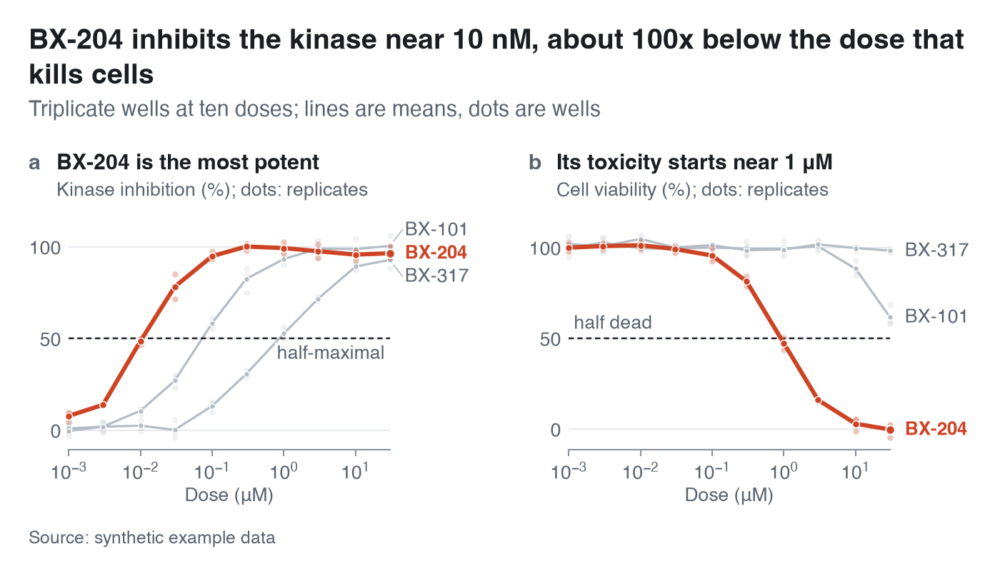
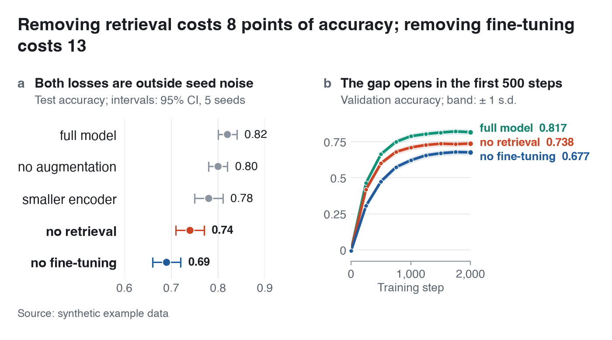

# figmint

**Figures that say one thing.** A Python toolkit, CLI and agent skill for two jobs:

1. **An agent explaining a scientific result to a person** — `fm.explain`: one takeaway sentence plus evidence panels, with the information-design rules built in and a machine-readable summary the agent checks its claim against.
2. **Journal-ready plates** — exact millimetre geometry, uniform typography, preflight QA and reproducible bundles for *Nature*, *Science*, *Cell*, PNAS and NeurIPS.

Both build on Matplotlib.





## Explain a result in a conversation (`fm.explain`)

Text is a poor carrier for five numbers, a trend or a spread; a default plot is a poor carrier for a conclusion. `fm.explain` asks the agent for the conclusion first and picks the encoding from the question each panel answers.

```python
import figmint as fm

fig = fm.explain(
    "Removing retrieval costs 8 points of accuracy; removing fine-tuning costs 13",
    fm.compare({"full model": 0.82, "no retrieval": 0.74, "no fine-tuning": 0.69},
               error={"full model": (0.80, 0.84), "no retrieval": (0.71, 0.77),
                      "no fine-tuning": (0.66, 0.72)},
               error_label="95% CI, 5 seeds",
               title="Both losses are outside seed noise", label="Test accuracy",
               highlight=["no retrieval", "no fine-tuning"]),
    fm.trend([0, 500, 1000, 1500, 2000],
             {"full model": [0.02, 0.61, 0.76, 0.80, 0.82],
              "no retrieval": [0.02, 0.52, 0.67, 0.72, 0.74],
              "no fine-tuning": [0.01, 0.44, 0.60, 0.66, 0.69]},
             title="The gap opens in the first 500 steps", label="Validation accuracy",
             x_label="Training step"),
    source="runs/ablation_2026-11 (5 seeds per variant)",
)
print(fig.save("ablation.png"))   # JSON: facts to check the claim against, issues to fix, alt text
```

| Question the panel answers | Form | Encoding |
| :--- | :--- | :--- |
| How do items differ in size? | `fm.compare` | sorted bars from zero; dots with whiskers when intervals are given, zero is meaningless or the scale is log |
| How does it change over time, dose or order? | `fm.trend` | lines labelled at their ends, measured points marked, replicates as dots, grey context, small multiples with `facet=True` |
| What moved between two states? | `fm.change` | slopegraph |
| How are raw values spread within groups? | `fm.distribution` | every observation as a dot with a median or mean mark |
| Do two measures move together? | `fm.relate` | scatter, optional groups, least-squares line with computed r and n |
| What makes up the total? | `fm.share` | sorted percentage bars, small parts folded into "Other" |
| How do two categorical dimensions interact? | `fm.matrix` | heat table with a number in every cell |

What makes it usable for scientific work:

- **Uncertainty is first class and must be named.** Raw replicates (`distribution`, `trend(points=)`), intervals (`compare(error=, error_label=)`) and bands (`trend(band=, band_label=)`); an interval with no stated meaning raises a warning.
- **Numbers keep their magnitude.** Values are shown to about three significant figures, as `1.3×10⁻⁷` when very small or large, and never rounded to zero. Log axes on `compare`, `trend`, `distribution` and `relate`.
- **One colour per entity.** A name keeps its colour in every panel of a figure, and `colors=` pins it across the figures of a conversation.
- **A summary the agent can check.** `fig.save()` returns JSON with computed `facts` per panel (highest, ratios, differences from the highlighted item, whether intervals overlap, crossings, missing values), `issues` with a `fix_hint` each, `alt_text`, and the smallest text size at chat width.
- **Errors that teach.** A broken rule or a wrong argument raises `ExplainError` with the fix in the message, so an agent recovers in one step.
- **Figures that come back.** Every PNG embeds its own spec: `fm.load("fig.png")` rebuilds it, so a returned figure can be revised from its data rather than redrawn from memory.
- **Inputs as they are.** Dicts, lists, numpy arrays, pandas Series and DataFrames; Unicode units and symbols (`µm`, `cm⁻³`, `χ²`).

The same figure from JSON, with no Python: `figmint explain spec.json --out fig.png` (`--example` prints a starter spec, `-` reads stdin, a figmint PNG is accepted as the spec source, `--show-spec fig.png` prints the embedded spec, `--style` overrides the visual style, `--write-spec` saves the normalised spec). Exit codes: `0` rendered, `1` rendered with an error-level issue, `2` the spec broke a rule and nothing was drawn.

**Visual styles (`style=`)** change the surface only, never the rules: `"figmint"` (default, white ground), `"bold"` (heavy lines on a matte-gray ground), `"editorial"` (serif headline, dotted gridlines) and `"sketch"` (hand-drawn, for illustrative points; warns unless `source=`/`note=` says the data is illustrative).

The full argument reference is in the agent skill, [src/figmint/assets/SKILL.md](src/figmint/assets/SKILL.md); a test fails if any public argument is missing from it or if its example stops running. Reference renders: [gallery/explain_science_examples.py](gallery/explain_science_examples.py) → `gallery/output/explain_science/`, [gallery/explain_chat_examples.py](gallery/explain_chat_examples.py) → `gallery/output/explain/`, and [gallery/explain_style_showcase.py](gallery/explain_style_showcase.py) → `gallery/output/explain_styles/`. An `Explanation` also works with the publication path: return it from `build()` and `figmint run` preflights and bundles it, or pass `target="nature"`.

### Design rules, and where they come from

| Rule the forms enforce | Basis |
| :--- | :--- |
| The title is the conclusion as a sentence; each panel has its own headline | Assertion–evidence structure (Alley & Neeley, *Technical Communication* 2005) |
| Quantities are encoded by position or length on a common scale; bars start at zero; no pies | Cleveland & McGill, *JASA* 1984 (ranking of elementary perceptual tasks) |
| At most 4 coloured series and 3 highlights; the rest is grey context or small multiples | Working-memory capacity of about four items (Cowan, *Behavioral and Brain Sciences* 2001); small multiples (Tufte 1983) |
| Labels sit on the data, not in a legend; all text horizontal | Spatial contiguity / split attention (Mayer, *Multimedia Learning*) |
| Raw observations and named intervals are shown rather than hidden in bars | Weissgerber et al., *PLoS Biology* 2015; Cumming et al., *J. Cell Biol.* 2007 (error bars must be defined) |
| A name keeps one colour across panels | Consistency of visual encoding across views (Qu & Hullman, *IEEE TVCG* 2018) |
| Series colours are separable under deuteranopia, protanopia and in grayscale; small text has at least 4.5:1 contrast | Machado et al. 2009 simulation; WCAG 2 contrast |
| Text is at least 11 px tall at a 700 px chat column | Legibility floor, measured after layout and reported in the summary |

## Publication figures

Default Matplotlib plots break journal guidelines in subtle ways when dropped into manuscripts: oversized 6.4" canvases shrink text below 5 pt when scaled to an 89 mm column, `bbox_inches="tight"` silently mutates your PDF MediaBox, Type 3 fonts break Adobe Illustrator editing, Computer Modern serif math clashes with Helvetica labels, and 50k-point scatters create multi-megabyte laggy PDFs. The publication path handles the geometry, rendering, verification and agent-automation layers:

- **Exact physical column widths** — locked PDF MediaBox dimensions (`89.0 mm`, `120.0 mm`, `183.0 mm` for *Nature*; `55.0 mm`, `120.0 mm`, `184.0 mm` for *Science*) with internal `constrained_layout` and versioned journal spec provenance (`spec_version`, `last_verified`, `source_url`).
- **Uniform sans-serif typography & math** — resolves Helvetica/Arial/Liberation Sans/DejaVu Sans for both body text and mathtext (`$10^{-4}$`, `$\mu\mathrm{m}$`, `$\Delta T$`, `$\mathrm{IC}_{50}$`) with TrueType Type 42 PDF embedding (`pdf.fonttype = 42`) and editable SVG text (`svg.fonttype = "none"`).
- **Multi-panel `Plate` engine** — grid and mosaic layouts with automatically aligned bold panel labels (`a, b, c` at 8 pt for *Nature*; `A, B, C` at 8.5 pt for *Science*) and per-panel issue attribution.
- **Publication & Tufte editorial primitives** — collision-free auto-stacked `sig_bracket`, microscopy `scalebar`, margin-trimmed `direct_labels`, `zoom_inset`, `despine`, `style_colorbar`, `emphasize`, plus Tufte primitives: `range_frame` (with optional marginal rugs), `ghost_context` (peer curves for small multiples), `tufte_boxplot`, `slopegraph`, and `sparkline`.
- **Hybrid vector/raster export** — `save_figure(..., rasterize_above=10_000)` selectively rasterizes dense scatter/mesh/line layers above a threshold (default 10,000 points) at journal combo DPI while keeping axes, ticks, and text crisp vector; the live figure's rasterization state is restored after saving (call `rasterize_heavy` directly to apply it permanently).
- **Reproducible exports** — PDF and SVG output omits creation timestamps and uses a fixed SVG id salt, so re-running the same script through `figmint run` yields byte-identical `figure.pdf`, `figure.svg`, and `preview.png`. `figmint run` and `figmint explain` pin `PYTHONHASHSEED=0`, because Matplotlib's embedding of bold fonts in PDF depends on Python's per-process hash seed; when saving from your own Python process, set `PYTHONHASHSEED=0` yourself for byte-identical PDFs.
- **One-command manuscript bundles & agent runner (`figmint run`)** — executes a plotting script, runs 14 high-precision checks (9 compliance rules + 5 clarity warnings: `color_separation`, `clarity_metadata`, `bar_baseline_nonzero`, `chartjunk_hints`, `text_on_data`) with `panels`, `element_locations`, and actionable `fix_hint`s in `schema_version: "0.2"` JSON, and exports a complete bundle (`figure.pdf`, `figure.svg`, `preview.png`, `proof.png`, `figure.tex`, `figure.json`, `reproduce.py`, `report.json`).
- **Built-in agent skill installer (`figmint skill --install`)** — ships curated `SKILL.md` and `AGENTS.md` instructions for Claude Code, Antigravity, Cursor, and Codex with a 2-loop repair cap.

## Installation

The name `figmint` is not available on PyPI, so install from the repository for now:

```bash
pip install git+https://github.com/blaiszik/figmint
# or, in a clone
uv sync --extra dev
```

Then give your agent the skill: `figmint skill --install` (Claude Code, Antigravity, Cursor, Codex, `AGENTS.md`).

## Publication quickstart

### Single-panel figure

```python
import numpy as np
import figmint as fm

fig, ax = fm.figure("nature", width="single", height_mm=62.0)
x = np.linspace(0, 10, 200)
ax.plot(x, np.exp(-x / 3.0), label="Control")
ax.plot(x, np.exp(-x / 6.0), label="Treated")
ax.set_xlabel("Time (h)")
ax.set_ylabel(r"Normalized signal ($\mu\mathrm{M}$)")
fm.direct_labels(ax)

fm.save_figure(fig, "figure1.pdf", journal="nature")
```

`journal=` accepts a journal name or `JournalSpec` and sets the default export DPI; when omitted, the journal tagged on the figure by `fm.figure` / `fm.Plate` is used.

### Multi-panel composite plate & manuscript bundle

```python
import figmint as fm


def build(journal: str = "nature") -> fm.Plate:
    plate = fm.Plate(
        journal=journal,    # switch to "science" for 184 mm + uppercase A, B, C
        width="double",     # 183.0 mm for Nature
        height_mm=118.0,
        layout=[["a", "b"], ["c", "d"]],
    )
    # Plot into plate["a"], plate["b"], plate["c"], plate["d"] ...
    plate.label_panels()
    return plate


if __name__ == "__main__":
    plate = build()
    bundle = plate.bundle("out/fig2", caption="Single-cell perturbation dynamics.")
    print(bundle.report.summary())
```

## CLI Workflow (`figmint run`, `check`, `specs`, `skill`)

### Run, preflight, and bundle a plotting script

`figmint run` executes a script exposing `def build(...) -> Plate | Figure` (or module-level `plate` / `fig`) under the headless Agg backend (so interactive backends cannot snap the canvas to whole screen pixels), validates against the target journal spec, and writes a complete manuscript bundle:

```bash
figmint run plot.py --journal nature --bundle out/ --json
figmint run plot.py --journal science --width full --bundle out_sci/ --strict
```

Exit codes:
- `0`: preflight passed (and 0 warnings under `--strict`)
- `1`: preflight error(s) found — inspect `issues[].rule`, `panel`, `panels`, `elements`, `element_locations`, and `fix_hint`
- `2`: script contract violation or Python runtime exception (still returns valid `schema_version: "0.2"` JSON)

Optional module-level metadata (`CAPTION`, `LABEL`, `TAKEAWAY`, `PANEL_NOTES`) in the script is automatically picked up by `figmint run --bundle`.

Each `--bundle out/` directory contains:
- `figure.pdf` — locked-mm Type 42 vector PDF (Adobe Illustrator editable, 0 Type 3 fonts)
- `figure.svg` — editable vector SVG (`svg.fonttype="none"`)
- `preview.png` — 300 DPI crisp preview for immediate inspection
- `proof.png` — compliance scorecard + Deuteranopia, Protanopia, and Grayscale print views
- `figure.tex` — ready-to-paste LaTeX `\begin{figure}` snippet with exact `\includegraphics[width=...mm]` and spec provenance comments
- `figure.json` — message-first sidecar with `takeaway`, `caption`, per-panel reading notes, encodings, and `reproduce_sha256`
- `reproduce.py` — copied source script for full reproducibility
- `report.json` — structured `schema_version: "0.2"` preflight report and artifact manifest

### Install bundled AI agent skills

Install `figmint`'s skill and repository instructions for Claude Code, Antigravity, Cursor, Codex, `AGENTS.md`, or `CLAUDE.md` (marker-based updates are strictly idempotent):

```bash
# Default targets: claude, antigravity, agents-md
figmint skill --install

# Select specific targets
figmint skill --install --target claude,antigravity,cursor,codex,agents-md,claude-md --root .

# Inspect skill or snippet without writing files
figmint skill --print
figmint skill --snippet
```

### Check existing PDFs & inspect journal specs

```bash
figmint check figure2.pdf --journal nature
figmint check figure2.pdf --journal science --json --strict
figmint specs
figmint specs --journal nature --json
```

## Supported Journal & Screen Specs

| Target | Width Presets (mm) | Max Height (mm) | Body / Tick / Panel Label | Panel Case | Default Palette | Combo / Line DPI |
| :--- | :--- | :---: | :---: | :---: | :---: | :---: |
| **Nature Portfolio** (`nature`) | `single`: 89, `mid`/`1.5col`: 120, `double`/`full`: 183 | 170 (247 page) | 6.5 / 6.0 / 8.0 pt | `a, b, c` | `nature` | 500 / 1000 |
| **Science (AAAS)** (`science`) | `single`: 55, `double`/`2col`: 120, `full`/`3col`: 184 | 180 (230 page) | 7.0 / 6.0 / 8.5 pt | `A, B, C` | `science` | 600 / 1200 |
| **Science Advances** (`science_advances`) | `single`: 84, `mid`: 120, `double`/`full`: 175 | 180 (230 page) | 7.0 / 6.0 / 8.5 pt | `A, B, C` | `science` | 600 / 1200 |
| **Cell Press** (`cell`) | `single`: 85, `mid`/`1.5col`: 114, `double`/`full`: 174 | 200 (230 page) | 7.0 / 6.0 / 8.5 pt | `A, B, C` | `nature_muted` | 500 / 1000 |
| **PNAS** (`pnas`) | `single`: 87, `mid`/`1.5col`: 114, `double`/`full`: 178 | 200 (225 page) | 7.0 / 6.5 / 9.0 pt | `A, B, C` | `nature_muted` | 600 / 1200 |
| **NeurIPS** (`neurips`) | `half`/`single`: 67, `mid`: 111.8, `double`/`full`: 139.7 | 180 (228.6 page) | 7.5 / 6.5 / 8.5 pt | `a, b, c` | `nature_muted` | 500 / 1000 |
| **Screen / Chat** (`screen`) | `chat`/`single`: 140, `wide`/`double`: 180, `slide`: 240 | 135 (160 page) | 8.5 / 7.5 / 10.0 pt | `a, b, c` | `nature_muted` | 220 / 300 |

Built-in palettes: `nature`, `nature_muted`, `science`, `okabe_ito`, `tol_bright`, `tol_muted`. Editorial colormaps: `figmint_navy`, `figmint_teal`, `figmint_coral`, `figmint_div`.

## Showcase Gallery & Empirical Validation

- **Showcase figures & benchmarks**: run `.venv/bin/python gallery/generate_showcase.py` to generate before/after comparisons, a 4-panel *Nature* double-column plate with CVD proof sheet, and a one-line *Nature* vs. *Science* switch comparison (detailed 8-dimension audit in [gallery/benchmark_comparison.md](gallery/benchmark_comparison.md)).
- **Empirical validation gate**: `evals/` benchmarks `figmint run --json` + `fix_hint` repair loops across 10 clean control scripts and 25 realistic messy agent-written scripts (`evals/eval_report.md`).

## Development & Testing

```bash
.venv/bin/pytest -v
.venv/bin/ruff check src tests gallery evals
```
