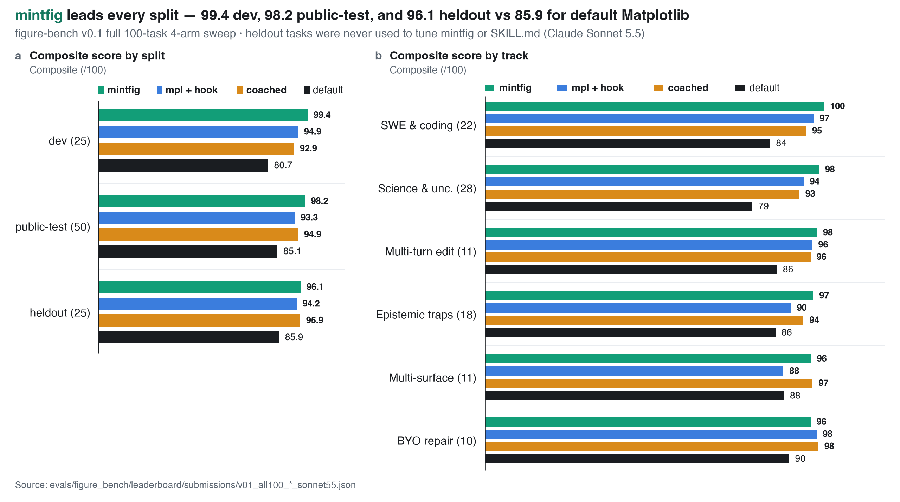
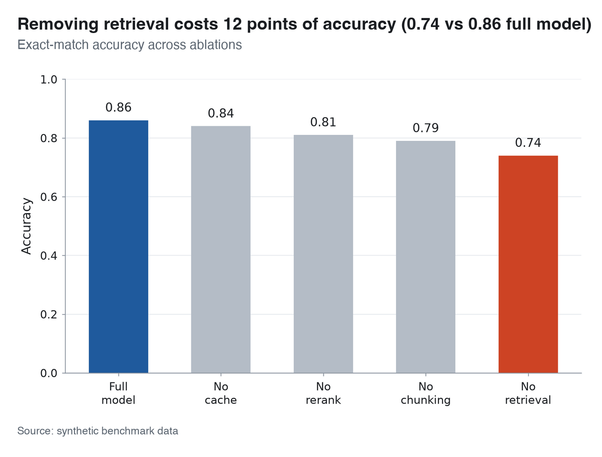
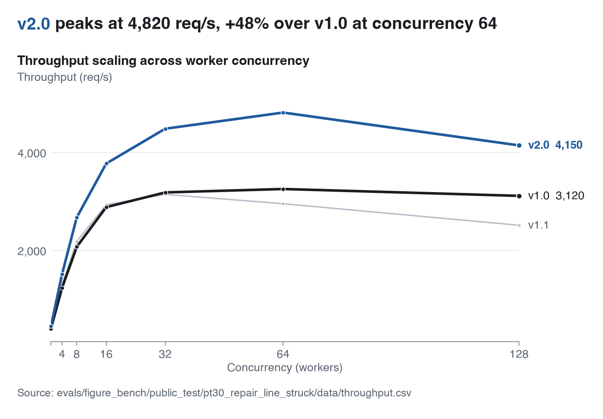

# figure-bench v0.1 — Results & Failure Anatomy

> **Work in progress (`v0.1`):** `figure-bench` includes **100 deterministic tasks** across 3 splits (`25 dev`, `50 public-test`, `25 heldout`) and 6 tracks, with a library-agnostic SVG + pixel + rubric scorer, full per-task/per-attempt timing capture, an external benchmark bridge ([`EXTERNAL_BENCHMARKS.md`](../evals/figure_bench/EXTERNAL_BENCHMARKS.md)), and an open PR leaderboard. Below are the full **100-task × 4-arm** measured results on Claude Sonnet 5.5 (400 fresh isolated runs, including a **Prompt-Coached Matplotlib** baseline with zero `mintfig` usage); additional models (`GPT`, `Gemini`, open-weights), plotting libraries (`seaborn`, `altair`, `plotly`, `ggplot2`), and human blind reader studies are welcome via PR.

**Why `figure-bench` exists:** AI coding agents already know how to call `matplotlib.pyplot`. The hard part is turning raw data into a figure that stays legible at actual chat/phone reading width (`700 px` / `450 px`), names its uncertainty honestly, refuses to overclaim noisy results, and states a headline number that actually matches the plotted data.

- **Benchmark runner & full spec:** [`evals/figure_bench/README.md`](../evals/figure_bench/README.md)
- **Interactive Leaderboard & Task Explorer:** [`evals/figure_bench/site/index.html`](../evals/figure_bench/site/index.html)
- **Human Blind Reader Study App:** [`evals/figure_bench/human_study/index.html`](../evals/figure_bench/human_study/index.html)
- **5-Minute Guide to Compete or Contribute:** [`evals/figure_bench/CONTRIBUTING.md`](../evals/figure_bench/CONTRIBUTING.md)

---

## 1. Results at a Glance

### Full 100-task agent sweep (`v0.1`, measured 2026-11-26 / 2026-11-27)


*400 fresh isolated Claude Code (`claude-sonnet-5-5`) runs — 100 tasks × 4 arms (`25 dev` + `50 public-test` + `25 heldout`), global hooks and MCP servers disabled for clean arm separation, audited neutrally via `Figure.savefig` (`neutral.py`) and the 4-dimension rubric (`rubric.py`). Verified leaderboard submissions: [`evals/figure_bench/leaderboard/submissions/`](../evals/figure_bench/leaderboard/submissions/).*

| Arm (100 tasks, Sonnet 5.5) | Saved | First-Submit Clean | Zero-Defect (Final) | Text >= 11 px | Right Headline # | Uncertainty Named | Median Time | Composite |
| :--- | ---: | ---: | ---: | ---: | ---: | ---: | ---: | ---: |
| **`mintfig` (`SKILL.md` + `mint.explain`)** | **100/100** | **87/100 (87.0%)** | **100/100 (100%)** | **100/100 (100%)** | **97/100 (97.0%)** | **55/57 (96.5%)** | **11.7 s** | **98.0** |
| **Plain Matplotlib + `mint.check` hook** | **100/100** | 57/100 (57.0%) | **91/100 (91.0%)** | **100/100 (100%)** | 73/100 (73.0%) | 39/57 (68.4%) | 13.9 s | **93.9** |
| **Prompt-Coached Matplotlib (style prompt, no `mintfig`)** | 98/100\* | 46/100 (46.0%) | 54/100 (54.0%)\* | **98/98 (100%)** | **93/98 (94.9%)** | **52/55 (94.5%)** | 12.9 s | **94.7** |
| **Plain Matplotlib, default (no prompt/hook)** | 99/100 | 31/100 (31.0%) | 35/100 (35.0%) *(65 defective)* | 49/99 (49.5%) *(median 10.9 px)* | 64/99 (64.6%) | 43/56 (76.8%) | **10.9 s** | **84.2** |

*\*On the 2 `surface="terminal"` tasks (`pt27`, `h23`), `matplotlib-coached` properly delivered fenced `<= 72`-col terminal blocks instead of saving PNGs (`56/100` clean overall including both terminal passes; `54/98` saved PNGs defect-free).*

#### Breakdown by split (`Composite / 100` and `Visual Quality / 100`)



| Split (Tasks) | `mintfig` | Matplotlib + `mint.check` hook | Matplotlib, coached | Matplotlib, default |
| :--- | ---: | ---: | ---: | ---: |
| **`dev`** (25) | **99.4** (`VQ 100.0`) | 94.9 (`VQ 97.6`) | 92.9 (`VQ 86.8`) | 80.7 (`VQ 74.2`) |
| **`public-test`** (50, frozen) | **98.2** (`VQ 100.0`) | 93.3 (`VQ 98.1`) | 94.9 (`VQ 92.5`) | 85.1 (`VQ 79.6`) |
| **`heldout`** (25, never tuned on) | **96.1** (`VQ 96.0`) | 94.2 (`VQ 98.0`) | 95.9 (`VQ 91.4`) | 85.9 (`VQ 82.0`) |

#### Breakdown by track (`Composite / 100`)

| Track (Tasks) | `mintfig` | Matplotlib + `mint.check` hook | Matplotlib, coached | Matplotlib, default |
| :--- | ---: | ---: | ---: | ---: |
| **`science_uncertainty`** (28) | **98.5** | 94.0 | 92.7 | 78.9 |
| **`swe_coding`** (22) | **100.0** | 96.9 | 94.7 | 84.1 |
| **`epistemic_traps`** (18) | **96.8** | 90.2 | 93.9 | 85.7 |
| **`multiturn_edit`** (11) | **97.9** | 96.5 | 96.0 | 86.1 |
| **`multi_surface`** (11) | 96.1 | 88.0 | **96.6** | 88.2 |
| **`byo_repair`** (10) | 96.0 | 97.8 | **98.3** | 89.7 |

#### Timing summary (Median / Mean / p90 across all 100 tasks)

| Arm | Task Total (s) | Time to First Submit (s) | Agent Think (s) | Render + Audit (s) | CLI API (s) | Arm Wall (8w) |
| :--- | ---: | ---: | ---: | ---: | ---: | ---: |
| **`mintfig`** | **11.7** / 13.3 / 20.3 | 10.6 / 11.2 / 14.7 | 10.5 / 11.9 / 17.4 | 0.63 / 0.82 / 1.55 | 12.2 / 13.2 / 19.2 | 218.0 s |
| **`matplotlib-hook`** | 13.9 / 14.8 / 21.9 | 11.1 / 11.2 / 14.2 | 13.2 / 13.9 / 20.7 | 0.61 / 0.90 / 1.56 | 14.6 / 15.3 / 22.6 | 234.1 s |
| **`matplotlib-coached`** | 12.9 / 13.7 / 18.5 | 12.5 / 13.0 / 16.5 | 12.2 / 12.9 / 17.0 | 0.60 / 0.79 / 1.15 | 15.8 / 16.7 / 21.8 | 220.0 s |
| **`matplotlib-plain`** | **10.9** / 11.2 / 14.7 | 10.5 / 10.8 / 13.9 | 10.4 / 10.6 / 13.5 | 0.46 / 0.55 / 0.71 | 11.9 / 12.1 / 15.0 | 183.5 s |

### Supporting automated evaluations

| Evaluation | Dataset | Key Measured Result | Report |
| :--- | :--- | :--- | :--- |
| **Initial 15-Task Seed Run** | 10 `dev` + 5 `heldout` (`r6` vs `b1` vs `u1`) | `mintfig` **15/15** clean & accurate headlines vs **2/15** clean / **4/15** headlines for default Matplotlib | [`evals/figure_bench/runs/compare_r6_b1_u1.md`](../evals/figure_bench/runs/compare_r6_b1_u1.md) |
| **Wild-50 `mint.check` Audit** | 50 realistic Matplotlib & Seaborn-idiom scripts (25 clean, 25 defective) | **0/25 (0.0%) false positives**, **25/25 (100%) defect catch**, **25/25 (100%) exact-rule recall** (down from 36% pre-hardening FP) | [`evals/check_bench/REPORT.md`](../evals/check_bench/REPORT.md) |
| **40-Prompt Skill Trigger Eval** | 20 quantitative/plotting prompts + 20 routine coding prompts (zero mentions of `mintfig`) | **100.0% recall (20/20)**, **0.0% false triggers (0/20)** (offline rubric; `--live` CLI adapter included) | [`evals/trigger_eval/REPORT.md`](../evals/trigger_eval/REPORT.md) |

### What these 100-task results show — and where room remains

- **Default Matplotlib fails reading-width layout on 65% of tasks (`65/100` defective).** Half of default Matplotlib figures (`50/99`) had text smaller than `11 px` at display width (median smallest text `10.9 px`), `19/99` had text crossed by lines, and `18/99` had malformed text (`ASCII minus`, `%%`, etc.).
- **Prompt coaching alone (`matplotlib-coached`) fixes content & font size — but still fails pixel geometry on 44% of tasks (`54/98` saved PNGs clean; `46%` first-submit clean).** Giving plain Matplotlib an explicit style/rubric prompt lifted headline accuracy to `94.9%` (`93/98`), named uncertainty to `94.5%` (`52/55`), and text legibility to `100%` (`98/98`), **yet without a layout engine or runtime geometry gate, 24% of figures still had text struck by lines (`74/98`), 17% had overlapping text (`81/98`), and 12% clipped past the canvas edge (`86/98`)**. You cannot prompt-engineer away Matplotlib pixel collisions.
- **The `mint.check` hook lifts plain Matplotlib from `35% → 91%` clean with zero library rewrite.** Giving the agent runtime `mint.check` feedback pushed text legibility to `100%`, cut overlaps to `1/100` and line crossings to `5/100`, and raised composite score from `84.2 → 93.9` (at a `+3.0 s` median latency cost for repair rounds).
- **`mintfig` combines both — shipping zero layout/text defects on all 100 tasks (`100/100` = 100%) and achieving `98.0` composite (`100.0` on `swe_coding`, `96.1` on `heldout`).** It achieved `87%` clean on the very first submission (vs `57%` hook / `46%` coached / `31%` plain), placed the verified quantitative answer in the headline on `97/100` figures, named uncertainty on `55/57` (`96.5%`), and finished faster at median than both `matplotlib-coached` (`12.9 s`) and `matplotlib-hook` (`13.9 s`) at `11.7 s`.
- **Transparent remaining gaps (14/100 non-perfect `mintfig` tasks):** On `h23_surface_terminal_ci_diff` (`surface="terminal"`), the `mintfig` agent delivered a PNG image instead of a `<= 72`-col fenced terminal block (`VQ 0.0`); on 3 repair tasks (`h25`, `pt48`, `pt50`), the reply cited the broken script's false number while contrasting it (`"not 9.2%"` / `"not 0.98"`) outside the 36-char negation window; and on 2 no-effect traps (`19_trap_dual_axis_spurious`, `pt42_trap_cherry_picked_window`), the headline stated the right number without an explicit null/noise keyword. All are cleanly tracked for v0.2, alongside display-width-locked human blind reader scores (`human_study/index.html`).

---

## 2. Failure Anatomy: Where Base Matplotlib & Unguided Agents Fail

Below are five recurring failure modes observed across agent-written Matplotlib/Seaborn scripts and `figure-bench` runs — paired with what `mint.check` catches automatically (zero rewrite) and how 1–2 lines of `mint.style()` / `mint.explain()` resolve them.

### Failure 1 — Truncated bar baselines & microscopic text at reading width

Agents frequently zoom bar charts (`ax.set_ylim(0.70, 0.88)`) to "highlight differences" on a wide `12×5 in` canvas. When scaled to a `700 px` chat column, tick and category labels shrink below `11 px`, while bar heights visually exaggerate a 12-point drop into a 5× cliff.

| Default agent Matplotlib (`mint.check` → `ship: false`) | Upgraded with `mint.style()` + `mint.explain()` (`ship: true`) |
| :---: | :---: |
|  |  |

**What `mint.check` flags:** `bar_baseline_nonzero` (error), `text_too_small` (`< 11 px` at 700 px chat width), `axis_unlabelled`, and `headline_states_no_number` ("Ablation Results").

---

### Failure 2 — Unlabelled uncertainty bands, boxed legends, & topic-only titles

When agents plot `ax.fill_between(...)` or `yerr=...`, they routinely omit *what* the interval represents (`± 1 s.d.`? `95% CI`? `SEM`? across how many seeds?), drop an opaque legend box over the data, and use a generic topic title instead of the finding.

| Default agent Matplotlib (`mint.check` → `ship: false`) | Upgraded with `mint.style()` + `mint.explain()` (`ship: true`) |
| :---: | :---: |
|  |  |

**What `mint.check` flags:** `interval_unlabelled`, `text_too_small`, and `headline_states_no_number`.

---

### Failure 3 — Rainbow / `jet` colormaps inventing false boundaries

Agents still reach for `cmap="jet"` or `rainbow` on heatmaps and matrices. Rainbow maps are non-monotonic in luminance, create artificial visual edges where data is smooth, and fail deuteranopia/protanopia and grayscale printouts.

| Default agent Matplotlib (`mint.check` → `ship: false`) | Upgraded with `mint.style()` + `mint.explain()` (`ship: true`) |
| :---: | :---: |
|  |  |

**What `mint.check` flags:** `rainbow_colormap` (error, suggesting `viridis` / `cividis` / `RdBu_r`) and `text_too_small`.

---

### Failure 4 — Line-struck labels, malformed strings (`%%`, ASCII `-`), & canvas clipping

When agents try to add direct annotations in plain Matplotlib (shown here from task [`pt30_repair_line_struck`](../evals/figure_bench/public_test/pt30_repair_line_struck/context.md)), labels collide with plotted lines, format strings leak `%%` or ASCII hyphens (`-19%`), and right-side labels clip past the canvas edge.

| Broken Matplotlib script (`mint.check` → `ship: false`) | Clean `mint.explain` render (`ship: true`) |
| :---: | :---: |
|  |  |

**What `mint.check` flags:** `text_struck_by_line`, `text_malformed` (`doubled %: 'v2.0 (+48%% at c=64)'`, `ASCII hyphen as minus sign`), and `text_clipped`.

---

### Failure 5 — Unlabelled axes & unchecked headline claims on distributions

On boxplots and scatter/regression figures, agents often leave the value axis unlabelled or write a title whose number drifts from the actual median/delta in the plotted data (`claim_number_mismatch`).

| Default agent Matplotlib (`mint.check` → `ship: false`) | Upgraded with `mint.style()` + `mint.explain()` (`ship: true`) |
| :---: | :---: |
|  |  |

**What `mint.check` flags:** `axis_unlabelled`, `text_too_small`, and `claim_number_mismatch` (naming the closest true derivation read directly from the Matplotlib artists).

---

### Failure 6 — Epistemic & statistical traps (where layout linting alone isn't enough)

Even clean-looking Matplotlib, Seaborn, Altair, or Plotly figures regularly fail scientific and engineering judgment. `figure-bench v0.1` adds **18 dedicated Epistemic Trap tasks** (`epistemic_traps`) testing whether an agent:
- **Refuses to overclaim overlapping CIs** (`13_trap_overlapping_ci`, `pt07_trap_no_speedup`, `h12_hyperfine_within_noise`, `h08_trap_overlap_clinical` — `no_effect_trap: true`).
- **Stratifies Simpson's paradox** instead of plotting a misleading pooled bar (`pt08_trap_simpson`).
- **Catches & discloses corrupted sensors or contaminated plates** (`14_trap_outlier_sensor`, `h09_trap_bad_batch`).
- **Shows raw points for `n=3` small samples** (`pt09_trap_small_n`) and **includes the placebo control** (`pt12_trap_missing_control`).
- **Refuses user bait to truncate a bar axis** (`pt11_trap_truncated_bait`) and avoids near-zero `%` blow-ups (`pt10_trap_near_zero_pct`).

---

## 3. The 100-Task `figure-bench v0.1` Suite

| Track | Tasks | Splits (`dev` / `public-test` / `heldout`) | Representative Tasks |
| :--- | ---: | :---: | :--- |
| **Science & Uncertainty** | 28 | 10 / 10 / 8 | Multi-seed ablations, dose–response, forest meta-analysis, Kaplan–Meier, reliability diagrams, Bland–Altman agreement, volcano omics, XRD/Raman spectra, CRISPR ranks, climate ensembles, PK profiles, catalyst tradeoffs |
| **SWE & Quantitative Coding** | 22 | 5 / 12 / 5 | GPU rooflines, DB query tails, cache MRCs, LLM serving SLAs, `hyperfine` & `pytest-benchmark` diffs, CI timelines & flake matrices, cloud cost waterfalls, GC pause tails, distributed scaling |
| **Epistemic Traps & Refusals** | 18 | 4 / 10 / 4 | Overlapping-CI no-effect traps, multiple testing, Simpson's paradox, ecological fallacy, survivorship bias, spurious dual axes, heavy-tail means, denominator shifts, cherry-picked windows, truncated-bar bait |
| **Multi-Turn Figure Editing** | 11 | 3 / 6 / 2 | Revise an existing figure: per-capita normalization, splitting confounders, sorting & SLA lines, replacing pies, exposing bimodal tails, switching baselines, linear → log, excluding QC faults |
| **Multi-Surface Delivery** | 11 | 2 / 6 / 3 | `450 px` phone/IDE/PR mobile cards, `1280 px` slides, dark NOC/dashboard cards, HTML reports, `<= 72`-col SSH terminal-only output |
| **BYO-Matplotlib Repair** | 10 | 1 / 6 / 3 | Repair broken existing Matplotlib scripts with wrong claims, truncated bars, `jet`/`rainbow` colormaps, dual-axis spaghetti, clipped pies, mislabelled SEM bars, and struck labels |
| **Total** | **100** | **25 / 50 / 25** | Validated cleanly by `python evals/figure_bench/bench.py validate-tasks` |

### Outside Data: External Benchmarks

To evaluate `mintfig` and `mint.check` on third-party benchmarks alongside `figure-bench`, see [`evals/figure_bench/EXTERNAL_BENCHMARKS.md`](../evals/figure_bench/EXTERNAL_BENCHMARKS.md) and [`evals/figure_bench/external_bridge.py`](../evals/figure_bench/external_bridge.py) (importers for **MatPlotBench** and **PandasPlotBench**, plus an arm-neutral output & timing auditor for **ChartMimic**, **Plot2Code**, and **VisEval**).

---

## 4. Compete or Help Improve `mintfig`

`figure-bench v0.1` is library-agnostic: `svg_audit.py` audits exported vector SVGs (`altair`, `plotly`, `d3`, `ggplot2`, `matplotlib`) and `pixel_audit.py` inspects any rendered PNG for display-width scaling, rainbow hue sweeps, and CVD/grayscale contrast — with zero `mintfig` dependency.

### Benchmark your own model, plotting library, or agent skill

```bash
# 1. Inspect the 50 frozen public-test tasks
python evals/figure_bench/bench.py list --split public-test

# 2. Run the 4-arm ablation ladder (including the prompt-coached plain Matplotlib baseline)
python evals/figure_bench/run_sweep.py --arms matplotlib-coached \
    --run-prefix evals/figure_bench/runs/v01_100_sonnet55 --split all --model sonnet --workers 8

# 3. Grade ANY output directory (<task_id>/{figure.png, reply.md, figure.svg?})
python evals/figure_bench/bench.py grade-dir my_outputs/ \
    --split public-test \
    --out evals/figure_bench/leaderboard/submissions/my_team_run.json

# 4. Verify and open a PR to appear on the leaderboard (verified automatically by GitHub Actions)
python evals/figure_bench/leaderboard/verify_submission.py evals/figure_bench/leaderboard/submissions/my_team_run.json
python evals/figure_bench/leaderboard/build_site.py
```

### Submit a real-world failure task

Hit a terrible agent-generated chart in your own research or engineering workflow? Turn it into a permanent benchmark task:

```bash
python evals/figure_bench/bench.py new-task --id pt51_my_case --split public-test --track swe_coding
python evals/figure_bench/bench.py validate-tasks
```

See [`evals/figure_bench/CONTRIBUTING.md`](../evals/figure_bench/CONTRIBUTING.md) for the full 5-minute submission checklist and human blind-reader study instructions.
