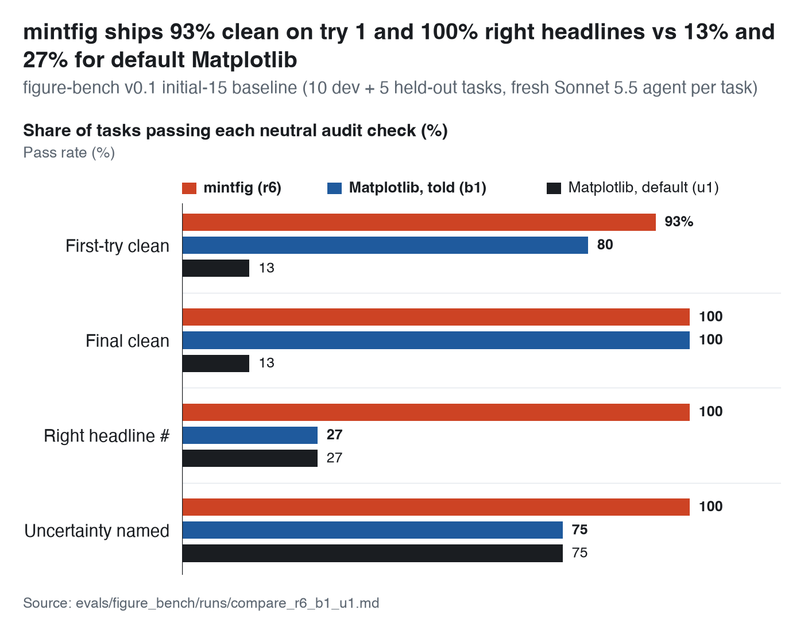
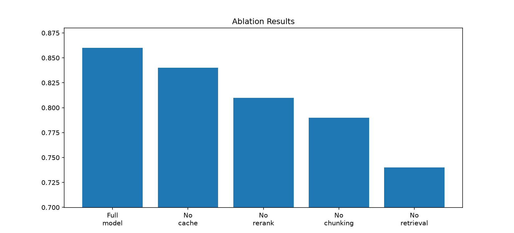
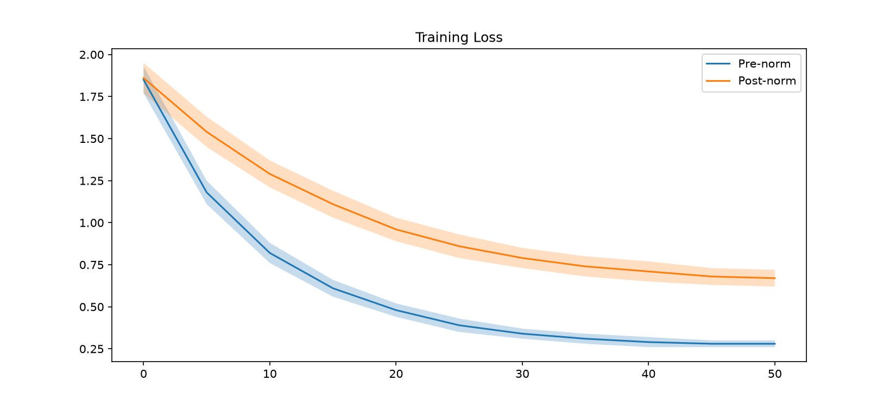
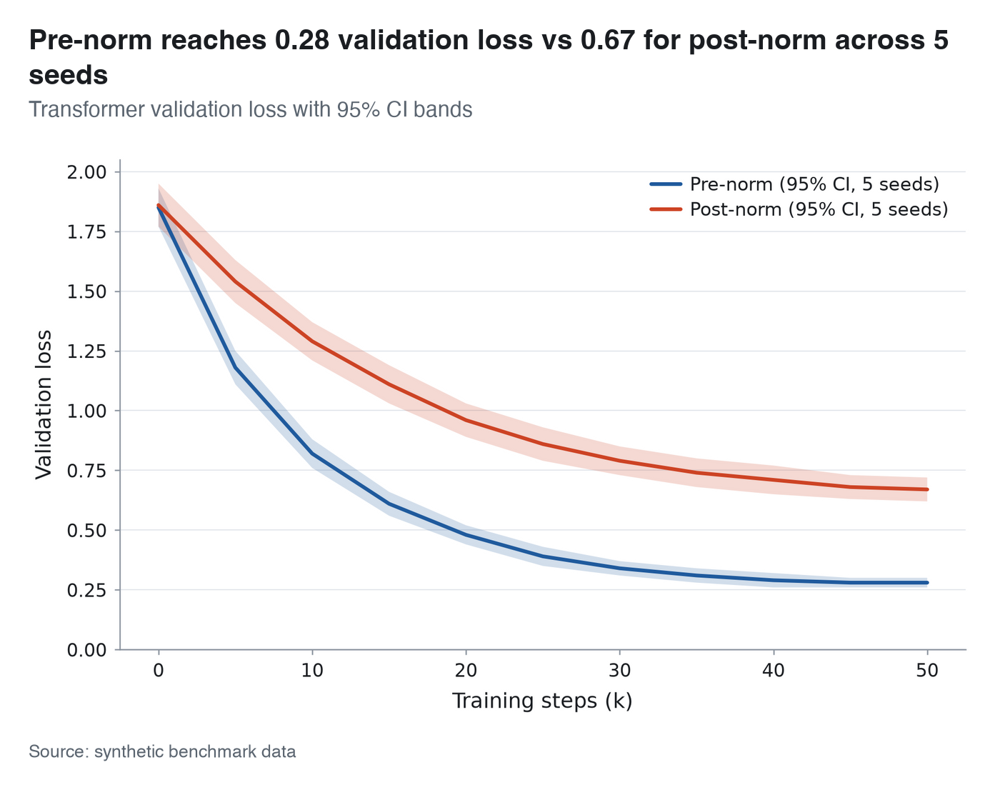
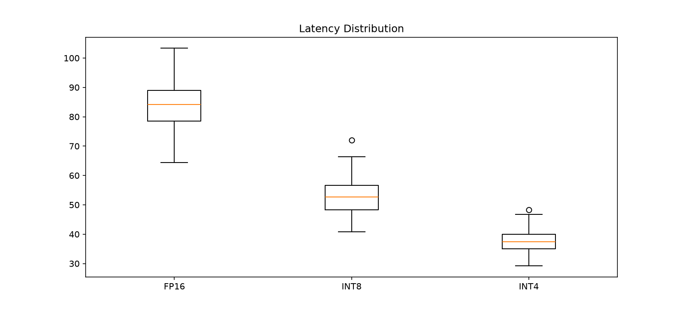
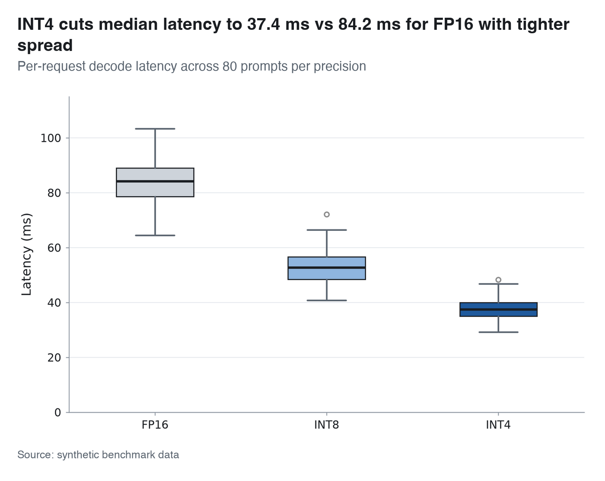

# figure-bench v0.1 — Results & Failure Anatomy

> **Work in progress (`v0.1`):** `figure-bench` now includes **60 deterministic tasks** across 3 splits (`15 dev`, `30 public-test`, `15 heldout`) and 6 tracks, with a library-agnostic SVG + pixel + rubric scorer and an open PR leaderboard. The measured agent comparison below reflects our **initial 15-task baseline (`v0.1-initial-15`)** while full 60-task runs across models and plotting libraries (`matplotlib`, `seaborn`, `altair`, `plotly`, `ggplot2`, `mintfig`, custom skills/hooks) are collected.

**Why `figure-bench` exists:** AI coding agents already know how to call `matplotlib.pyplot`. The hard part is turning raw data into a figure that stays legible at actual chat/phone reading width (`700 px` / `450 px`), names its uncertainty honestly, refuses to overclaim noisy results, and states a headline number that actually matches the plotted data.

- **Benchmark runner & full spec:** [`evals/figure_bench/README.md`](../evals/figure_bench/README.md)
- **Interactive Leaderboard & Task Explorer:** [`evals/figure_bench/site/index.html`](../evals/figure_bench/site/index.html)
- **Human Blind Reader Study App:** [`evals/figure_bench/human_study/index.html`](../evals/figure_bench/human_study/index.html)
- **5-Minute Guide to Compete or Contribute:** [`evals/figure_bench/CONTRIBUTING.md`](../evals/figure_bench/CONTRIBUTING.md)

---

## 1. Results at a Glance

### Agent comparison (`v0.1-initial-15`, measured 2026-11-25)



*Full raw breakdown and methodology: [`evals/figure_bench/runs/compare_r6_b1_u1.md`](../evals/figure_bench/runs/compare_r6_b1_u1.md) (10 `dev` + 5 `heldout` tasks, one fresh Claude Sonnet 5.5 agent per task and arm, audited neutrally via `Figure.savefig` without importing `mintfig`).*

| Arm (`v0.1-initial-15`) | First-Try Clean | Final Clean | Text >= 11 px at 700 px | Right Headline # | Uncertainty Named | Median Time | Composite |
| :--- | ---: | ---: | ---: | ---: | ---: | ---: | ---: |
| **`mintfig` (`r6`)** | **93.3%** (14/15) | **100.0%** (15/15) | **100%** (15/15) | **100.0%** (15/15) | **100%** (4/4) | 16.6 s | **100.0** |
| **Matplotlib, told rules (`b1`)** | 80.0% (12/15) | 100.0% (15/15) | 100% (15/15) | 26.7% (4/15) | 75% (3/4) | 19.5 s | **68.4** |
| **Matplotlib, default (`u1`)** | **13.3%** (2/15) | **13.3%** (2/15) | **40%** (6/15) | **26.7%** (4/15) | 75% (3/4) | 14.8 s | **33.4** |

### Supporting automated evaluations

| Evaluation | Dataset | Key Measured Result | Report |
| :--- | :--- | :--- | :--- |
| **Wild-50 `mint.check` Audit** | 50 realistic Matplotlib & Seaborn-idiom scripts (25 clean, 25 defective) | **0/25 (0.0%) false positives**, **25/25 (100%) defect catch**, **25/25 (100%) exact-rule recall** (down from 36% pre-hardening FP) | [`evals/check_bench/REPORT.md`](../evals/check_bench/REPORT.md) |
| **40-Prompt Skill Trigger Eval** | 20 quantitative/plotting prompts + 20 routine coding prompts (zero mentions of `mintfig`) | **100.0% recall (20/20)**, **0.0% false triggers (0/20)** (offline rubric; `--live` CLI adapter included) | [`evals/trigger_eval/REPORT.md`](../evals/trigger_eval/REPORT.md) |

### What these results do — and do not — prove yet

- **Unguided Matplotlib fails layout at reading width almost every time (`13/15` defective in `u1`).** Agents default to wide `12×5 in` canvases, small tick/axis fonts, rotated labels, and annotations placed right over data lines.
- **Even when told the display width and layout checks (`b1`), plain Matplotlib still misses the message.** `b1` fixed final layout defects (`15/15`), yet put the verified quantitative answer in the headline in only **4 of 15** figures (vs. **15 of 15** for `mintfig`) and missed naming uncertainty on 1 of 4 replicate/seed tasks.
- **Caveat on reader comprehension:** In that early 15-task run, blind VLM readers given full-resolution PNGs extracted the single primary number across all three arms (`15/15` after correcting one swapped folder ID). That is why `figure-bench v0.1` adds **display-width-locked (`700 px` / `450 px`) 3-question blind reader studies** (primary value + uncertainty judgment + caveat) and a dedicated **Epistemic Traps** track (`no_effect_trap` overlapping CIs, Simpson's paradox, outliers, truncated-bar bait).

---

## 2. Failure Anatomy: Where Base Matplotlib & Unguided Agents Fail

Below are five recurring failure modes observed across agent-written Matplotlib/Seaborn scripts and `figure-bench` runs — paired with what `mint.check` catches automatically (zero rewrite) and how 1–2 lines of `mint.style()` / `mint.explain()` resolve them.

### Failure 1 — Truncated bar baselines & microscopic text at reading width

Agents frequently zoom bar charts (`ax.set_ylim(0.70, 0.88)`) to "highlight differences" on a wide `12×5 in` canvas. When scaled to a `700 px` chat column, tick and category labels shrink below `11 px`, while bar heights visually exaggerate a 12-point drop into a 5× cliff.

| Default agent Matplotlib (`mint.check` → `ship: false`) | Upgraded with `mint.style()` + `mint.explain()` (`ship: true`) |
| :---: | :---: |
|  |  |

**What `mint.check` flags:** `bar_baseline_nonzero` (error), `text_too_small` (`< 11 px` at 700 px chat width), `axis_unlabelled`, and `headline_states_no_number` ("Ablation Results").

---

### Failure 2 — Unlabelled uncertainty bands, boxed legends, & topic-only titles

When agents plot `ax.fill_between(...)` or `yerr=...`, they routinely omit *what* the interval represents (`± 1 s.d.`? `95% CI`? `SEM`? across how many seeds?), drop an opaque legend box over the data, and use a generic topic title instead of the finding.

| Default agent Matplotlib (`mint.check` → `ship: false`) | Upgraded with `mint.style()` + `mint.explain()` (`ship: true`) |
| :---: | :---: |
|  |  |

**What `mint.check` flags:** `interval_unlabelled`, `text_too_small`, and `headline_states_no_number`.

---

### Failure 3 — Rainbow / `jet` colormaps inventing false boundaries

Agents still reach for `cmap="jet"` or `rainbow` on heatmaps and matrices. Rainbow maps are non-monotonic in luminance, create artificial visual edges where data is smooth, and fail deuteranopia/protanopia and grayscale printouts.

| Default agent Matplotlib (`mint.check` → `ship: false`) | Upgraded with `mint.style()` + `mint.explain()` (`ship: true`) |
| :---: | :---: |
|  |  |

**What `mint.check` flags:** `rainbow_colormap` (error, suggesting `viridis` / `cividis` / `RdBu_r`) and `text_too_small`.

---

### Failure 4 — Line-struck labels, malformed strings (`%%`, ASCII `-`), & canvas clipping

When agents try to add direct annotations in plain Matplotlib (shown here from task [`pt30_repair_line_struck`](../evals/figure_bench/public_test/pt30_repair_line_struck/context.md)), labels collide with plotted lines, format strings leak `%%` or ASCII hyphens (`-19%`), and right-side labels clip past the canvas edge.

| Broken Matplotlib script (`mint.check` → `ship: false`) | Clean `mint.explain` render (`ship: true`) |
| :---: | :---: |
|  |  |

**What `mint.check` flags:** `text_struck_by_line`, `text_malformed` (`doubled %: 'v2.0 (+48%% at c=64)'`, `ASCII hyphen as minus sign`), and `text_clipped`.

---

### Failure 5 — Unlabelled axes & unchecked headline claims on distributions

On boxplots and scatter/regression figures, agents often leave the value axis unlabelled or write a title whose number drifts from the actual median/delta in the plotted data (`claim_number_mismatch`).

| Default agent Matplotlib (`mint.check` → `ship: false`) | Upgraded with `mint.style()` + `mint.explain()` (`ship: true`) |
| :---: | :---: |
|  |  |

**What `mint.check` flags:** `axis_unlabelled`, `text_too_small`, and `claim_number_mismatch` (naming the closest true derivation read directly from the Matplotlib artists).

---

### Failure 6 — Epistemic & statistical traps (where layout linting alone isn't enough)

Even clean-looking Matplotlib, Seaborn, Altair, or Plotly figures regularly fail scientific and engineering judgment. `figure-bench v0.1` adds **12 dedicated Epistemic Trap tasks** (`epistemic_traps`) testing whether an agent:
- **Refuses to overclaim overlapping CIs** (`13_trap_overlapping_ci`, `pt07_trap_no_speedup`, `h12_hyperfine_within_noise`, `h08_trap_overlap_clinical` — `no_effect_trap: true`).
- **Stratifies Simpson's paradox** instead of plotting a misleading pooled bar (`pt08_trap_simpson`).
- **Catches & discloses corrupted sensors or contaminated plates** (`14_trap_outlier_sensor`, `h09_trap_bad_batch`).
- **Shows raw points for `n=3` small samples** (`pt09_trap_small_n`) and **includes the placebo control** (`pt12_trap_missing_control`).
- **Refuses user bait to truncate a bar axis** (`pt11_trap_truncated_bait`) and avoids near-zero `%` blow-ups (`pt10_trap_near_zero_pct`).

---

## 3. The 60-Task `figure-bench v0.1` Suite

| Track | Tasks | Splits (`dev` / `public-test` / `heldout`) | Representative Tasks |
| :--- | ---: | :---: | :--- |
| **Science & Uncertainty** | 19 | 7 / 7 / 5 | Multi-seed ablations, dose–response, forest meta-analysis, Kaplan–Meier, volcano omics, Raman peaks, Arrhenius kinetics, RL seed bands, Michaelis–Menten |
| **SWE & Quantitative Coding** | 13 | 2 / 8 / 3 | `hyperfine` & `pytest-benchmark` diffs, CI pipeline timelines, Chrome Trace builds, `k6` p99 deploy spikes, `esbuild` bundle waterfalls, LLM Pareto frontiers |
| **Epistemic Traps & Refusals** | 12 | 4 / 6 / 2 | Overlapping-CI no-effect traps, Simpson's paradox, corrupted sensors, contaminated plates, small-n, near-zero `%`, truncated-bar bait, missing controls |
| **Multi-Turn Figure Editing** | 6 | 2 / 3 / 1 | Revise an existing figure: switch baseline, convert linear → log, add hidden replicates, fix mW/W units, highlight failing subset |
| **Multi-Surface Delivery** | 5 | 0 / 4 / 1 | `450 px` phone/IDE sidebar, `1280 px` slide, dark dashboard card, `<= 72`-col SSH terminal-only output |
| **BYO-Matplotlib Repair** | 5 | 0 / 3 / 2 | Repair broken existing Matplotlib scripts with planted wrong claims, truncated bars, `jet` colormaps, struck labels, and unlabelled CI bands |
| **Total** | **60** | **15 / 30 / 15** | Validated cleanly by `python evals/figure_bench/bench.py validate-tasks` |

---

## 4. Compete or Help Improve `mintfig`

`figure-bench v0.1` is library-agnostic: `svg_audit.py` audits exported vector SVGs (`altair`, `plotly`, `d3`, `ggplot2`, `matplotlib`) and `pixel_audit.py` inspects any rendered PNG for display-width scaling, rainbow hue sweeps, and CVD/grayscale contrast — with zero `mintfig` dependency.

### Benchmark your own model, plotting library, or agent skill

```bash
# 1. Inspect the 30 frozen public-test tasks
python evals/figure_bench/bench.py list --split public-test

# 2. Grade ANY output directory (<task_id>/{figure.png, reply.md, figure.svg?})
python evals/figure_bench/bench.py grade-dir my_outputs/ \
    --split public-test \
    --out evals/figure_bench/leaderboard/submissions/my_team_run.json

# 3. Verify and open a PR to appear on the leaderboard (verified automatically by GitHub Actions)
python evals/figure_bench/leaderboard/verify_submission.py evals/figure_bench/leaderboard/submissions/my_team_run.json
python evals/figure_bench/leaderboard/build_site.py
```

### Submit a real-world failure task

Hit a terrible agent-generated chart in your own research or engineering workflow? Turn it into a permanent benchmark task:

```bash
python evals/figure_bench/bench.py new-task --id pt31_my_case --split public-test --track swe_coding
python evals/figure_bench/bench.py validate-tasks
```

See [`evals/figure_bench/CONTRIBUTING.md`](../evals/figure_bench/CONTRIBUTING.md) for the full 5-minute submission checklist and human blind-reader study instructions.
