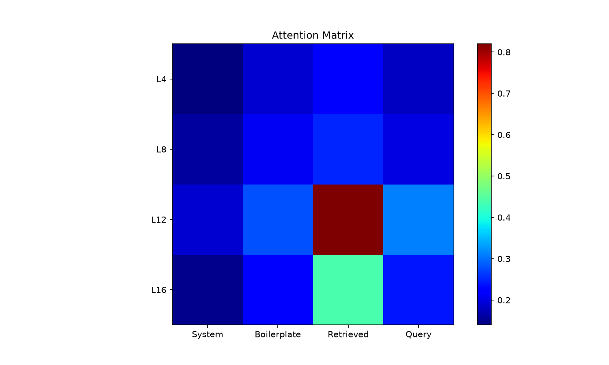
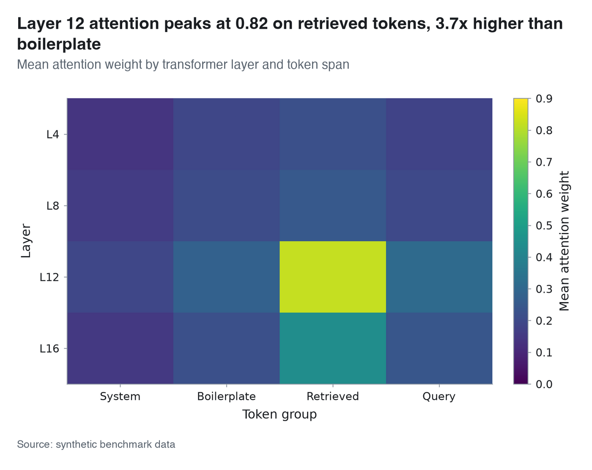
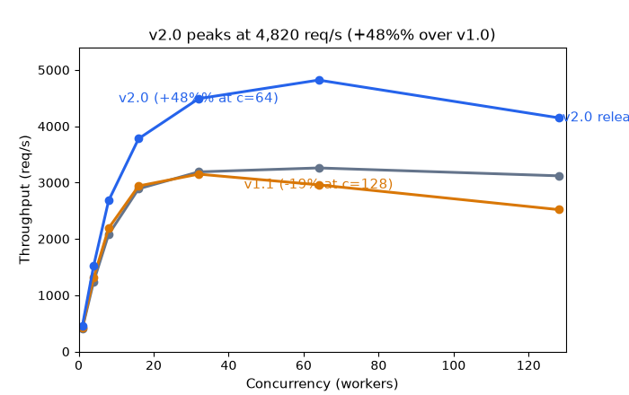

# figure-bench v0.1 — Results & Failure Anatomy

> **Work in progress (`v0.1`):** `figure-bench` includes **60 deterministic tasks** across 3 splits (`15 dev`, `30 public-test`, `15 heldout`) and 6 tracks, with a library-agnostic SVG + pixel + rubric scorer and an open PR leaderboard. Below are the full **60-task × 3-arm** measured results on Claude Sonnet 5.5 (180 fresh isolated runs); additional models (`GPT`, `Gemini`, open-weights), plotting libraries (`seaborn`, `altair`, `plotly`, `ggplot2`), and human blind reader studies are welcome via PR.

**Why `figure-bench` exists:** AI coding agents already know how to call `matplotlib.pyplot`. The hard part is turning raw data into a figure that stays legible at actual chat/phone reading width (`700 px` / `450 px`), names its uncertainty honestly, refuses to overclaim noisy results, and states a headline number that actually matches the plotted data.

- **Benchmark runner & full spec:** [`evals/figure_bench/README.md`](../evals/figure_bench/README.md)
- **Interactive Leaderboard & Task Explorer:** [`evals/figure_bench/site/index.html`](../evals/figure_bench/site/index.html)
- **Human Blind Reader Study App:** [`evals/figure_bench/human_study/index.html`](../evals/figure_bench/human_study/index.html)
- **5-Minute Guide to Compete or Contribute:** [`evals/figure_bench/CONTRIBUTING.md`](../evals/figure_bench/CONTRIBUTING.md)

---

## 1. Results at a Glance

### Full 60-task agent sweep (`v0.1`, measured 2026-11-26)


*180 fresh isolated Claude Code (`claude-sonnet-5-5`) runs — 60 tasks × 3 arms (`15 dev` + `30 public-test` + `15 heldout`), global hooks and MCP servers disabled for clean arm separation, audited neutrally via `Figure.savefig` (`neutral.py`) and the 4-dimension rubric (`rubric.py`). Verified leaderboard submissions: [`evals/figure_bench/leaderboard/submissions/`](../evals/figure_bench/leaderboard/submissions/).*

| Arm (60 tasks, Sonnet 5.5) | Saved | Zero-Defect (Final) | Text >= 11 px | Right Headline # | Uncertainty Named | Median Time | Composite |
| :--- | ---: | ---: | ---: | ---: | ---: | ---: | ---: |
| **`mintfig` (`SKILL.md` + `mint.explain`)** | 57/60 | **57/60 (95.0%)** *(0/57 saved defects)* | **57/57 (100%)** | **53/60 (88.3%)** *(93.0% of saved)* | **29/33 (87.9%)** | **13.4 s** | **93.5** |
| **Plain Matplotlib + `mint.check` hook** | 57/60 | **48/60 (80.0%)** | **56/57 (98.2%)** | 39/60 (65.0%) *(68.4% of saved)* | 20/31 (64.5%) | 17.4 s | **89.2** |
| **Plain Matplotlib, default (no hook)** | 60/60 | **21/60 (35.0%)** *(39/60 defective)* | **28/60 (46.7%)** *(median 10.9 px)* | 36/60 (60.0%) | 24/33 (72.7%) | 15.4 s | **81.6** |

#### Breakdown by split (`Composite / 100` and `Visual Quality / 100`)

| Split (Tasks) | `mintfig` | Matplotlib + `mint.check` hook | Matplotlib, default |
| :--- | ---: | ---: | ---: |
| **`dev`** (15) | **97.7** (`VQ 93.3`) | 96.0 (`VQ 96.0`) | 82.3 (`VQ 72.3`) |
| **`public-test`** (30, frozen) | **89.7** (`VQ 93.3`) | 88.9 (`VQ 92.3`) | 81.0 (`VQ 77.0`) |
| **`heldout`** (15, never tuned on) | **97.0** (`VQ 100.0`) | 83.1 (`VQ 85.7`) | 82.2 (`VQ 85.3`) |

### Supporting automated evaluations

| Evaluation | Dataset | Key Measured Result | Report |
| :--- | :--- | :--- | :--- |
| **Initial 15-Task Seed Run** | 10 `dev` + 5 `heldout` (`r6` vs `b1` vs `u1`) | `mintfig` **15/15** clean & accurate headlines vs **2/15** clean / **4/15** headlines for default Matplotlib | [`evals/figure_bench/runs/compare_r6_b1_u1.md`](../evals/figure_bench/runs/compare_r6_b1_u1.md) |
| **Wild-50 `mint.check` Audit** | 50 realistic Matplotlib & Seaborn-idiom scripts (25 clean, 25 defective) | **0/25 (0.0%) false positives**, **25/25 (100%) defect catch**, **25/25 (100%) exact-rule recall** (down from 36% pre-hardening FP) | [`evals/check_bench/REPORT.md`](../evals/check_bench/REPORT.md) |
| **40-Prompt Skill Trigger Eval** | 20 quantitative/plotting prompts + 20 routine coding prompts (zero mentions of `mintfig`) | **100.0% recall (20/20)**, **0.0% false triggers (0/20)** (offline rubric; `--live` CLI adapter included) | [`evals/trigger_eval/REPORT.md`](../evals/trigger_eval/REPORT.md) |

### What these 60-task results show — and where room remains

- **Default Matplotlib fails reading-width layout on 65% of tasks (`39/60` defective).** More than half of default Matplotlib figures (`32/60`) had text smaller than `11 px` at display width (median smallest text `10.9 px`), `11/60` had text crossed by lines, and `11/60` had malformed text (`ASCII minus`, `%%`, etc.).
- **The `mint.check` hook lifts plain Matplotlib from `35% → 80%` clean with zero library rewrite.** Giving the agent `mint.check` feedback on submit pushed text legibility from `46.7% → 98.2%`, eliminated all malformed text (`57/57`), and raised composite score from `81.6 → 89.2`.
- **`mintfig` ships zero layout/text defects on every saved figure (`57/57` = 100%) and generalizes to `heldout` (`97.0` composite, `100.0` visual quality).** It also placed the verified quantitative answer in the headline on `53/57` saved figures (`93.0%`) and finished fastest (`13.4 s` median).
- **Transparent failure notes (3 unsaved `mintfig` tasks):** On 3 of 60 tasks (`09_eval_matrix`, `pt19_k6_latency_deploy`, `pt22_signup_funnel`), `mintfig`'s strict pre-save layout/API guards raised an `ExplainError` (e.g., wide matrix column headers or a tuple argument mistake on `trend(reference=...)`) and the agent exhausted its 3-attempt cap without saving. Hardening `SKILL.md` examples and error recovery for those 3 patterns is tracked for v0.2, alongside display-width-locked human blind reader scores (`human_study/index.html`).

---

## 2. Failure Anatomy: Where Base Matplotlib & Unguided Agents Fail

Below are five recurring failure modes observed across agent-written Matplotlib/Seaborn scripts and `figure-bench` runs — paired with what `mint.check` catches automatically (zero rewrite) and how 1–2 lines of `mint.style()` / `mint.explain()` resolve them.

### Failure 1 — Truncated bar baselines & microscopic text at reading width

Agents frequently zoom bar charts (`ax.set_ylim(0.70, 0.88)`) to "highlight differences" on a wide `12×5 in` canvas. When scaled to a `700 px` chat column, tick and category labels shrink below `11 px`, while bar heights visually exaggerate a 12-point drop into a 5× cliff.

| Default agent Matplotlib (`mint.check` → `ship: false`) | Upgraded with `mint.style()` + `mint.explain()` (`ship: true`) |
| :---: | :---: |
|  |  |

**What `mint.check` flags:** `bar_baseline_nonzero` (error), `text_too_small` (`< 11 px` at 700 px chat width), `axis_unlabelled`, and `headline_states_no_number` ("Ablation Results").

---

### Failure 2 — Unlabelled uncertainty bands, boxed legends, & topic-only titles

When agents plot `ax.fill_between(...)` or `yerr=...`, they routinely omit *what* the interval represents (`± 1 s.d.`? `95% CI`? `SEM`? across how many seeds?), drop an opaque legend box over the data, and use a generic topic title instead of the finding.

| Default agent Matplotlib (`mint.check` → `ship: false`) | Upgraded with `mint.style()` + `mint.explain()` (`ship: true`) |
| :---: | :---: |
|  |  |

**What `mint.check` flags:** `interval_unlabelled`, `text_too_small`, and `headline_states_no_number`.

---

### Failure 3 — Rainbow / `jet` colormaps inventing false boundaries

Agents still reach for `cmap="jet"` or `rainbow` on heatmaps and matrices. Rainbow maps are non-monotonic in luminance, create artificial visual edges where data is smooth, and fail deuteranopia/protanopia and grayscale printouts.

| Default agent Matplotlib (`mint.check` → `ship: false`) | Upgraded with `mint.style()` + `mint.explain()` (`ship: true`) |
| :---: | :---: |
|  |  |

**What `mint.check` flags:** `rainbow_colormap` (error, suggesting `viridis` / `cividis` / `RdBu_r`) and `text_too_small`.

---

### Failure 4 — Line-struck labels, malformed strings (`%%`, ASCII `-`), & canvas clipping

When agents try to add direct annotations in plain Matplotlib (shown here from task [`pt30_repair_line_struck`](../evals/figure_bench/public_test/pt30_repair_line_struck/context.md)), labels collide with plotted lines, format strings leak `%%` or ASCII hyphens (`-19%`), and right-side labels clip past the canvas edge.

| Broken Matplotlib script (`mint.check` → `ship: false`) | Clean `mint.explain` render (`ship: true`) |
| :---: | :---: |
|  |  |

**What `mint.check` flags:** `text_struck_by_line`, `text_malformed` (`doubled %: 'v2.0 (+48%% at c=64)'`, `ASCII hyphen as minus sign`), and `text_clipped`.

---

### Failure 5 — Unlabelled axes & unchecked headline claims on distributions

On boxplots and scatter/regression figures, agents often leave the value axis unlabelled or write a title whose number drifts from the actual median/delta in the plotted data (`claim_number_mismatch`).

| Default agent Matplotlib (`mint.check` → `ship: false`) | Upgraded with `mint.style()` + `mint.explain()` (`ship: true`) |
| :---: | :---: |
|  |  |

**What `mint.check` flags:** `axis_unlabelled`, `text_too_small`, and `claim_number_mismatch` (naming the closest true derivation read directly from the Matplotlib artists).

---

### Failure 6 — Epistemic & statistical traps (where layout linting alone isn't enough)

Even clean-looking Matplotlib, Seaborn, Altair, or Plotly figures regularly fail scientific and engineering judgment. `figure-bench v0.1` adds **12 dedicated Epistemic Trap tasks** (`epistemic_traps`) testing whether an agent:
- **Refuses to overclaim overlapping CIs** (`13_trap_overlapping_ci`, `pt07_trap_no_speedup`, `h12_hyperfine_within_noise`, `h08_trap_overlap_clinical` — `no_effect_trap: true`).
- **Stratifies Simpson's paradox** instead of plotting a misleading pooled bar (`pt08_trap_simpson`).
- **Catches & discloses corrupted sensors or contaminated plates** (`14_trap_outlier_sensor`, `h09_trap_bad_batch`).
- **Shows raw points for `n=3` small samples** (`pt09_trap_small_n`) and **includes the placebo control** (`pt12_trap_missing_control`).
- **Refuses user bait to truncate a bar axis** (`pt11_trap_truncated_bait`) and avoids near-zero `%` blow-ups (`pt10_trap_near_zero_pct`).

---

## 3. The 60-Task `figure-bench v0.1` Suite

| Track | Tasks | Splits (`dev` / `public-test` / `heldout`) | Representative Tasks |
| :--- | ---: | :---: | :--- |
| **Science & Uncertainty** | 19 | 7 / 7 / 5 | Multi-seed ablations, dose–response, forest meta-analysis, Kaplan–Meier, volcano omics, Raman peaks, Arrhenius kinetics, RL seed bands, Michaelis–Menten |
| **SWE & Quantitative Coding** | 13 | 2 / 8 / 3 | `hyperfine` & `pytest-benchmark` diffs, CI pipeline timelines, Chrome Trace builds, `k6` p99 deploy spikes, `esbuild` bundle waterfalls, LLM Pareto frontiers |
| **Epistemic Traps & Refusals** | 12 | 4 / 6 / 2 | Overlapping-CI no-effect traps, Simpson's paradox, corrupted sensors, contaminated plates, small-n, near-zero `%`, truncated-bar bait, missing controls |
| **Multi-Turn Figure Editing** | 6 | 2 / 3 / 1 | Revise an existing figure: switch baseline, convert linear → log, add hidden replicates, fix mW/W units, highlight failing subset |
| **Multi-Surface Delivery** | 5 | 0 / 4 / 1 | `450 px` phone/IDE sidebar, `1280 px` slide, dark dashboard card, `<= 72`-col SSH terminal-only output |
| **BYO-Matplotlib Repair** | 5 | 0 / 3 / 2 | Repair broken existing Matplotlib scripts with planted wrong claims, truncated bars, `jet` colormaps, struck labels, and unlabelled CI bands |
| **Total** | **60** | **15 / 30 / 15** | Validated cleanly by `python evals/figure_bench/bench.py validate-tasks` |

---

## 4. Compete or Help Improve `mintfig`

`figure-bench v0.1` is library-agnostic: `svg_audit.py` audits exported vector SVGs (`altair`, `plotly`, `d3`, `ggplot2`, `matplotlib`) and `pixel_audit.py` inspects any rendered PNG for display-width scaling, rainbow hue sweeps, and CVD/grayscale contrast — with zero `mintfig` dependency.

### Benchmark your own model, plotting library, or agent skill

```bash
# 1. Inspect the 30 frozen public-test tasks
python evals/figure_bench/bench.py list --split public-test

# 2. Grade ANY output directory (<task_id>/{figure.png, reply.md, figure.svg?})
python evals/figure_bench/bench.py grade-dir my_outputs/ \
    --split public-test \
    --out evals/figure_bench/leaderboard/submissions/my_team_run.json

# 3. Verify and open a PR to appear on the leaderboard (verified automatically by GitHub Actions)
python evals/figure_bench/leaderboard/verify_submission.py evals/figure_bench/leaderboard/submissions/my_team_run.json
python evals/figure_bench/leaderboard/build_site.py
```

### Submit a real-world failure task

Hit a terrible agent-generated chart in your own research or engineering workflow? Turn it into a permanent benchmark task:

```bash
python evals/figure_bench/bench.py new-task --id pt31_my_case --split public-test --track swe_coding
python evals/figure_bench/bench.py validate-tasks
```

See [`evals/figure_bench/CONTRIBUTING.md`](../evals/figure_bench/CONTRIBUTING.md) for the full 5-minute submission checklist and human blind-reader study instructions.
