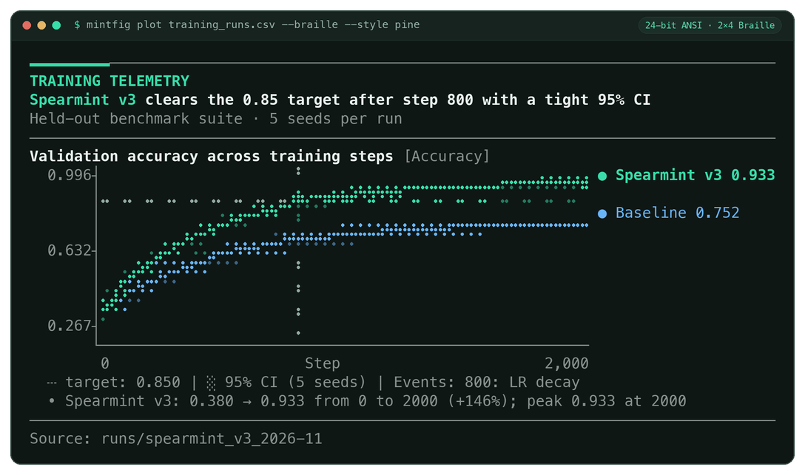
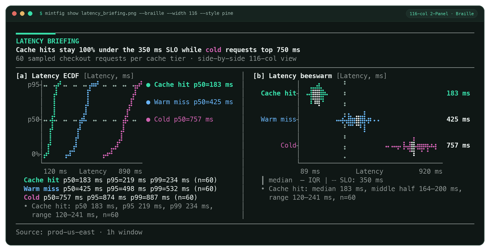
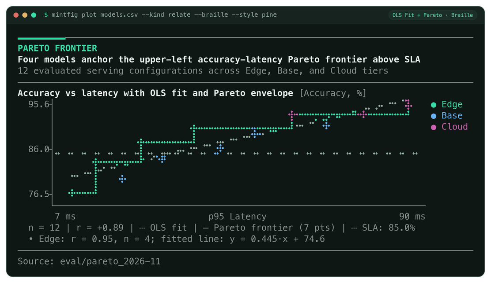
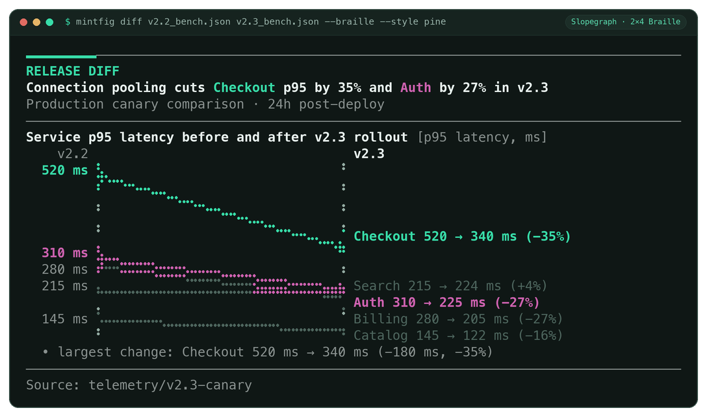
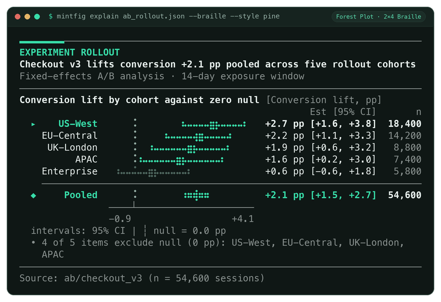
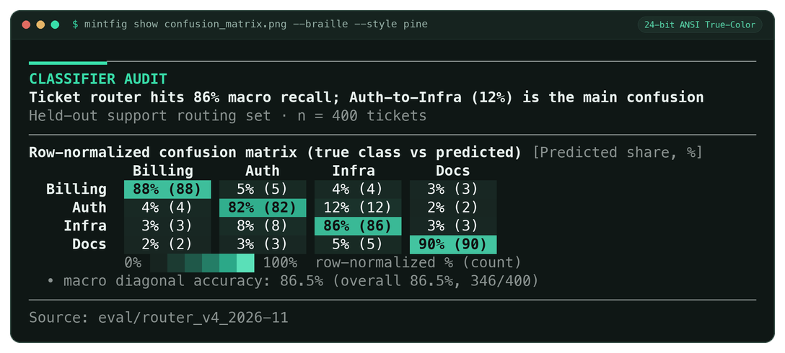
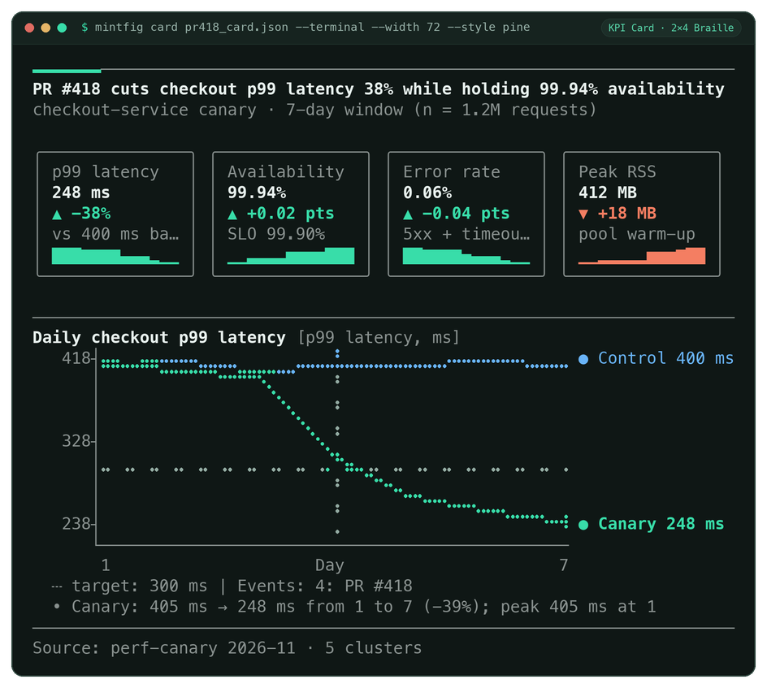
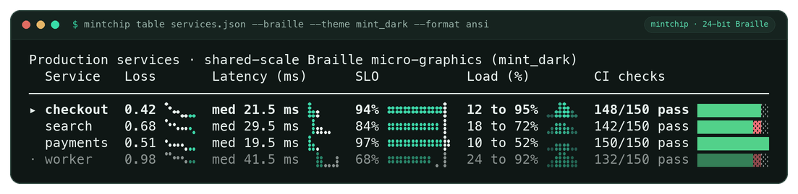

# Terminal Braille & 24-bit True-Color Rendering

`mintfig` and [`mintchip`](https://github.com/blaiszik/mintchip) render high-resolution **2×4 Unicode Braille** charts (`U+2800..U+28FF`) and **24-bit ANSI true-color** heatmaps directly in any modern terminal (Ghostty, Kitty, iTerm2, WezTerm, Alacritty, tmux, SSH sessions, and CI logs) — with zero inline-image protocol required, automatic `width="auto"` sizing (clamped `56..132` columns), side-by-side 2-panel composition at `width >= 104`, and `NO_COLOR` / `FORCE_COLOR` support.

> Every preview below was captured directly from the live `render_terminal(..., high_res=True, color=True)`, `SummaryCard.to_terminal(...)`, and `mintchip` (`braille=True`, `theme="mint_dark"`) renderers by [`gallery/braille_terminal_gallery.py`](../gallery/braille_terminal_gallery.py). Inspect any raw ANSI capture in your own terminal with `cat gallery/output/terminal/01_trend_ci_band.txt`.

## Quick Reference

| Surface / Task | Python | CLI |
| :--- | :--- | :--- |
| High-res Braille figure | `fig.to_text(mode="braille", width="auto")` | `mintfig plot data.csv --braille --style pine` |
| Print directly to terminal | `fig.show(mode="braille")` | `mintfig show fig.png --braille --width auto` |
| Render JSON spec in terminal | `mint.load("spec.json").show(mode="braille")` | `mintfig explain spec.json --braille --style pine` |
| Benchmark diff slopegraph | `mint.explain(..., mint.change(...)).show(mode="braille")` | `mintfig diff base.json head.json --braille` |
| Live-reloading file monitor | — | `mintfig watch train.csv --braille --style pine` |
| PR / Release KPI card | `mint.card(...).to_terminal(width=82, style="pine")` | `mintfig card spec.json --terminal --style pine` |
| Inline Braille `mintchip` table | `tbl.text(braille=True, color=True)` | `mintchip table rows.json --braille --theme mint_dark --format ansi` |

Set `NO_COLOR=1` (or pass `color=False` / `--no-color`) for clean monochrome Braille, or `mode="ascii"` / `--ascii` for pure 7-bit ASCII logs.

---

## 1. Training Curves with Shaded 95% CI Bands (`mint.trend`)

Stippled 25%-dither confidence bands (`band=`), vertical `events=` markers, horizontal `reference=` target line, uppercase editorial `kicker=`, and direct colored end labels in `style="pine"`.



```python
import mintfig as mint

fig = mint.explain(
    "Spearmint v3 clears the 0.85 target after step 800 with a tight 95% CI",
    mint.trend(
        steps,
        {"Spearmint v3": spearmint, "Baseline": baseline},
        band={"Spearmint v3": ci_sp, "Baseline": ci_base},
        band_label="95% CI (5 seeds)",
        events={800: "LR decay"},
        reference=(0.85, "target"),
        highlight="Spearmint v3",
        title="Validation accuracy across training steps",
        label="Accuracy",
        x_label="Step",
    ),
    kicker="Training Telemetry",
    style="pine",
)
fig.show(mode="braille", width=84)
```

```bash
mintfig plot training_runs.csv --braille --style pine
```

Raw ANSI: [`01_trend_ci_band.txt`](../gallery/output/terminal/01_trend_ci_band.txt)

---

## 2. Wide Side-by-Side 2-Panel Briefing (`mode="ecdf"` + `mode="swarm"`)

At `width >= 104`, two-panel rows (`layout=[["a", "b"]]`) compose side-by-side with an ANSI-aware vertical gutter (`  │  `), pairing cumulative tail curves (`mode="ecdf"`) with deterministic symmetric Braille beeswarm clouds (`mode="swarm"`), white median/IQR overlays, and aligned tabular medians. Narrower terminals automatically stack vertically.



```python
fig = mint.explain(
    "Cache hits stay 100% under the 350 ms SLO while cold requests top 750 ms",
    mint.distribution(groups, mode="ecdf", highlight="Cache hit", reference=(350.0, "SLO"),
                      title="Latency ECDF", label="Latency", unit="ms"),
    mint.distribution(groups, mode="swarm", highlight="Cache hit", reference=(350.0, "SLO"),
                      title="Latency beeswarm", label="Latency", unit="ms"),
    layout=[["a", "b"]],
    kicker="Latency Briefing",
    style="pine",
)
fig.show(mode="braille", width=116)
```

```bash
mintfig show latency_briefing.png --braille --width 116 --style pine
```

Raw ANSI: [`02_wide_ecdf_and_swarm.txt`](../gallery/output/terminal/02_wide_ecdf_and_swarm.txt)

---

## 3. Grouped Scatter, OLS Fit & Pareto Frontier (`mint.relate`)

Grouped scatter points with a dashed ordinary-least-squares regression line (`fit=True`), upper-left Pareto staircase hull (`frontier=True`), SLA reference line, and computed `r` / fitted slope summary.



```python
fig = mint.explain(
    "Four models anchor the upper-left accuracy-latency Pareto frontier above SLA",
    mint.relate(
        latencies, accuracies, names=names, groups=tiers,
        fit=True, frontier=True, reference=(85.0, "SLA"), highlight="Edge",
        x_label="p95 Latency", x_unit="ms", y_label="Accuracy", unit="%",
        title="Accuracy vs latency with OLS fit and Pareto envelope",
    ),
    kicker="Pareto Frontier",
    style="pine",
)
fig.show(mode="braille", width=86)
```

```bash
mintfig plot models.csv --kind relate --braille --style pine
```

Raw ANSI: [`03_relate_pareto_fit.txt`](../gallery/output/terminal/03_relate_pareto_fit.txt)

---

## 4. Paired Before/After Slopegraph (`mint.change`)

Angled Braille trajectories linking two states (`v2.2` → `v2.3`) with collision-free right-hand labels and inline colored percentage deltas.



```python
fig = mint.explain(
    "Connection pooling cuts Checkout p95 by 35% and Auth by 27% in v2.3",
    mint.change(
        {"Checkout": 520, "Auth": 310, "Billing": 280, "Search": 215, "Catalog": 145},
        {"Checkout": 340, "Auth": 225, "Billing": 205, "Search": 224, "Catalog": 122},
        labels=("v2.2", "v2.3"), highlight=["Checkout", "Auth"],
        title="Service p95 latency before and after v2.3 rollout",
        label="p95 latency", unit="ms",
    ),
    kicker="Release Diff",
    style="pine",
)
fig.show(mode="braille", width=84)
```

```bash
mintfig diff v2.2_bench.json v2.3_bench.json --braille --style pine
```

Raw ANSI: [`04_change_slopegraph.txt`](../gallery/output/terminal/04_change_slopegraph.txt)

---

## 5. A/B Rollout Forest Plot (`mint.forest`)

Dashed vertical null line (`reference=0.0`), Braille 95% CI whiskers and point estimates, rule-separated pooled summary diamond (`◆`), and right-aligned tabular `Est [95% CI]` and `n` columns.



```python
fig = mint.explain(
    "Checkout v3 lifts conversion +2.1 pp pooled across five rollout cohorts",
    mint.forest(
        effects, error=cis, error_label="95% CI", reference=0.0,
        pooled={"label": "Pooled", "value": 2.1, "lo": 1.5, "hi": 2.7, "n": 54600},
        n=sample_sizes, highlight="US-West",
        title="Conversion lift by cohort against zero null",
        label="Conversion lift", unit="pp",
    ),
    kicker="Experiment Rollout",
    style="pine",
)
fig.show(mode="braille", width=90)
```

```bash
mintfig explain ab_rollout.json --braille --style pine
```

Raw ANSI: [`05_forest_ab_rollout.txt`](../gallery/output/terminal/05_forest_ab_rollout.txt)

---

## 6. 24-bit True-Color Confusion Matrix (`mint.matrix`)

True-color ANSI background heatmap (`\x1b[48;2;r;g;bm`) interpolated from the active theme's sequential (or diverging) stops with automatic WCAG `#111111` / `#F8FAFC` foreground contrast, `normalize="row"`, `show_counts=True`, and a box-table fallback when `color=False`.



```python
fig = mint.explain(
    "Ticket router hits 86% macro recall; Auth-to-Infra (12%) is the main confusion",
    mint.matrix(
        [[88, 5, 4, 3], [4, 82, 12, 2], [3, 8, 86, 3], [2, 3, 5, 90]],
        rows=["Billing", "Auth", "Infra", "Docs"],
        cols=["Billing", "Auth", "Infra", "Docs"],
        normalize="row", show_counts=True,
        title="Row-normalized confusion matrix (true class vs predicted)",
        label="Predicted share",
    ),
    kicker="Classifier Audit",
    style="pine",
)
fig.show(mode="braille", width=84)
```

```bash
mintfig show confusion_matrix.png --braille --style pine
```

Raw ANSI: [`06_matrix_confusion_truecolor.txt`](../gallery/output/terminal/06_matrix_confusion_truecolor.txt)

---

## 7. PR & Release KPI Summary Card (`mint.card`)

Rounded Unicode KPI tiles (`╭─╮` / `╰─╯`, auto-wrapping when narrow) with semantic green/crimson deltas, 2-row Braille sparklines inside each tile, and a full attached Braille chart panel underneath.



```python
card = mint.card(
    "PR #418 cuts checkout p99 latency 38% while holding 99.94% availability",
    metrics,
    panel=mint.trend(
        [1, 2, 3, 4, 5, 6, 7],
        {"Canary": canary, "Control": control},
        events={4: "PR #418"}, reference=(300.0, "target"),
        highlight="Canary", title="Daily checkout p99 latency",
        label="p99 latency", unit="ms", x_label="Day",
    ),
    subtitle="checkout-service canary · 7-day window (n = 1.2M requests)",
    source="perf-canary 2026-11 · 5 clusters",
    style="pine",
)
print(card.to_terminal(width=82, color=True, style="pine"))
```

```bash
mintfig card pr418_card.json --terminal --width 82 --style pine
```

Raw ANSI: [`07_kpi_summary_card.txt`](../gallery/output/terminal/07_kpi_summary_card.txt)

---

## 8. Shared-Scale `mintchip` Braille Table (`spark`, `hist`, `bullet`, `heat`, `status`)

Companion inline micro-graphics from [`mintchip`](https://github.com/blaiszik/mintchip) with `braille=True` packing two samples/bins per character cell, graduated 24-bit RGB `mint_dark` heat strips, row highlighting, and shared column scales.



```python
import mintchip as mc
from mintchip.render.text_base import ansi_theme

tbl = mc.table(
    rows,
    {
        "service": {"chip": "text", "header": "Service"},
        "loss": {"chip": "spark", "header": "Loss"},
        "latency": {"chip": "hist", "header": "Latency (ms)", "bins": 8, "unit": "ms"},
        "slo": {"chip": "bullet", "header": "SLO", "ranges": (0.6, 0.85, 1.0)},
        "load": {"chip": "heat", "header": "Load (%)", "unit": "%"},
        "checks": {"chip": "status", "header": "CI checks"},
    },
    title="Production services · shared-scale Braille micro-graphics (mint_dark)",
    highlight=["checkout"],
    baseline="worker",
)
with ansi_theme("mint_dark"):
    print(tbl.text(braille=True, color=True, width=124))
```

```bash
mintchip table services.json --braille --theme mint_dark --format ansi
```

Raw ANSI: [`08_mintchip_braille_table.txt`](../gallery/output/terminal/08_mintchip_braille_table.txt)

---

## Live Terminal Monitoring (`mintfig watch`)

Watch any evolving CSV, TSV, JSON, or JSONL log file (training metrics, benchmark runs, latency telemetry) and re-render cleanly on every file update:

```bash
mintfig watch train_metrics.csv --braille --style pine --interval 1.0 --width auto
mintfig watch bench.jsonl --braille --kind auto --takeaway "Checkout p99 live monitor" --once
```
