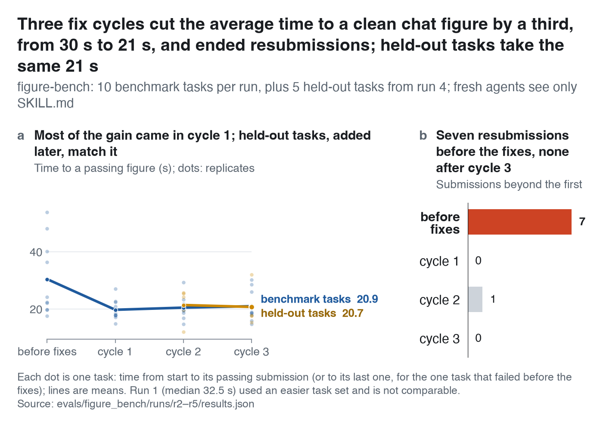

# figure-bench



`make_progress.py` draws this with mintfig from `runs/r2`–`r5/results.json`. Run 1 used an earlier, easier task set.

Ten tasks that mimic a real agent thread: a short conversation (`context.md`)
in which a person shares data and asks for one figure, plus the data
(`data/*.csv`). The agent under test sees only its task folder and mintfig's
`SKILL.md`, writes a script that calls `mint.explain(...).save("figure.png")`,
and submits it.

| Task | Domain | What the figure must show |
| :--- | :--- | :--- |
| `01_ablation` | ML | Accuracy of two components against seed noise, weighed against a second table of latency cost |
| `02_ab_latency` | Product | Two latency distributions, medians and tail |
| `03_dose_response` | Pharmacology | Four dose–response curves (one inactive), where each crosses 50% |
| `04_battery_fade` | Batteries | Capacity fade to 80%, with a defective cell to exclude and say so |
| `05_retrofit` | Energy | Daily use before/after a retrofit, with a control building and a gap |
| `06_energy_mix` | Policy | **Edit a returned figure** (`data/sent_figure.png`): fix a wrong definition, keep the rest |
| `07_gene_change` | Genomics | Fold changes of 24 genes read by group, housekeeping flat |
| `08_hall_petch` | Materials | Yield strength vs grain size, per-alloy fits |
| `09_eval_matrix` | ML | Language × task grid against a previous checkpoint: did the gap close? |
| `10_incident` | Ops | Five services' error rates on a log axis, one spike |

Five more **held-out** tasks live in `heldout/` (survey shares, spectra, wait times,
scaling exponents, a signed budget change). They were added after the first fix cycle
and are never used to tune mintfig or SKILL.md; `grade` reports them separately.

## Scoring

- **Time:** from `start` to the end of the first passing `submit`; it
  includes the agent's reading and thinking.
- **Checks** (all must pass): the script runs; exactly one `mint.explain` figure
  saved as `figure.png`; no error-level issue; **no warnings**; smallest text
  >= 11 px at the 700 px chat width; chat width (700 px, or 450 px `narrow` for phones,
  accepted since r6); a number in the takeaway;
  every panel titled; built-in forms only (no `mint.custom`); the PNG's embedded
  spec rebuilds; a `source=`; alt text. At most 3 submissions.
- **Independent layout audit** (does not trust mintfig's own issues): the figure
  is rebuilt from its embedded spec and every text matplotlib actually draws is
  checked: no two texts overlap, no text is crossed by a line, and no malformed
  text ("%%", repeated words such as "Share of Share of", an ASCII hyphen used
  as a minus sign, "nan"/"None").
- **Local renders:** agents are told not to render outside `submit`; images in
  the work folder that `submit` did not make are counted and reported.
- **Answer key** (reported by `grade` only, never by `submit`): a number in
  the takeaway matches the task's key quantity within tolerance
  (`answers.json`). Agents must not read it.
- **Delivery** (`reply_delivers_figure`): the agent hands in the reply it would
  send the person (`submit ... --reply reply.md`). It passes when the reply shows
  the figure, either as the image in `deliver.markdown` (``) or
  as `deliver.text` inside a fenced block, with at most 60 words of prose outside
  the image line and code fences. It is reported beside the checks and in
  `grade`'s Delivery column; it does not decide the pass, so times stay comparable
  across runs. Runs r1–r5 predate it and read "not provided".

## The Matplotlib arm (baseline)

`start --arm matplotlib` runs the same task as a baseline. The agent gets no
SKILL.md and writes plain Matplotlib (numpy and pandas allowed; importing mintfig
fails the `no_mintfig` check). It is told the figure is shown at most 700 px wide
and which defects are checked. It passes on the arm-neutral defect checks only, so
its gate is looser than the mintfig arm's (which also needs no mintfig warnings,
titled panels, a source and so on).

**Neutral audit** (`neutral.py`, both arms, every submission): a hook on
`Figure.savefig` measures the figure that was written to `figure.png`, at the
moment it was saved, without importing mintfig.

- Smallest text as displayed. The PNG is shown at min(700 px, its own width), so a
  point of text is `dpi / 72 * shown / png_width` px. The floor is 11 px.
- Overlapping texts, text crossed by a line (texts on an opaque legend frame or box
  are skipped), malformed text, and text past the canvas edge (skipped for
  `bbox_inches="tight"`).
- Whether the headline (suptitle, figure texts, axes titles) states a number, and
  whether a number in the headline or in the reply's prose matches the answer key.
- On tasks whose data carries seed, replicate or sampling error (`01`, `03`, `07`,
  `h1`): whether any drawn text names the uncertainty (CI, s.d., seeds, replicates,
  n = ...).
- For information only: legends, panels, rainbow colormaps.

The audit is conservative: it does not flag labels on top of markers, colour
mismatches across panels, or a missing control, so it understates what plain
Matplotlib gets wrong rather than overstating it. `grade` reports it for the first
and the final submission; `compare` puts graded runs side by side:

```bash
python evals/figure_bench/bench.py start 01_ablation --run runs/b1 --arm matplotlib --python <python>
python evals/figure_bench/bench.py compare runs/r6 runs/b1 --out runs/compare_r6_b1.md
```

### Results: r6 vs b1 vs u1 (2026-11-25)

Full table and notes: `runs/compare_r6_b1_u1.md`. 15 tasks, one fresh Sonnet 5.5 agent
per task and arm. `b1` was told the display width and the checks; `u1` was told neither.

| First submission | mintfig (r6) | Matplotlib, told (b1) | Matplotlib, not told (u1) |
| :--- | ---: | ---: | ---: |
| No layout or text defect | 14/15 | 12/15 | **2/15** |
| Smallest text >= 11 px at 700 px | 14/14 | 15/15 | 6/14 |
| Headline number matches the answer key | **13/14** | 4/15 | 4/14 |
| Blind reader answers from the figure alone* | 15/15 | 15/15 | 15/15 |

\* After correcting one reader that swapped two folder ids (both Matplotlib figures).

What this does and does not show:

- Not told the constraints, an agent writing Matplotlib ships a layout or text defect
  in 13 of 15 figures: labels drawn over lines, and text at 9–11 px in a 700 px column.
  Told them, it fixes nearly all of them. mintfig needs no telling.
- mintfig figures state the answer in the headline; Matplotlib figures put it in a
  legend, a bar label or nowhere (4 of 15 headlines carry the key number).
- Blind VLM readers found the key number in every arm. At full resolution, with a
  question that names what to look for, plain Matplotlib from a strong model
  communicates the number as well. This is not yet evidence that mintfig figures are
  read faster or more correctly by people; that needs display-size images and human
  readers (ADOPTION_PLAN C3).
- mintfig's own failures here (fixed after the run): `low_density` is reported as a warning (one task used
  all 3 attempts on it), agents choose `width="narrow"` for phone readers and fail the
  700 px check, and the `trend(points=)` format is only in `references/science.md`.

`evals/figure_bench/.venv` (git-ignored) is the bench's own environment: mintfig
(editable), pandas and Matplotlib.

## Running

```bash
python evals/figure_bench/make_data.py            # (re)writes data and answers.json, deterministic
python evals/figure_bench/bench.py list
python evals/figure_bench/bench.py start 01_ablation --run runs/r1 --python <python with mintfig+pandas>
# the agent works in runs/r1/01_ablation/ and submits its script and its reply:
python evals/figure_bench/bench.py submit 01_ablation --run runs/r1 runs/r1/01_ablation/figure_script.py \
    --reply runs/r1/01_ablation/reply.md
python evals/figure_bench/bench.py grade --run runs/r1   # writes results.json and results.md
```

Every attempt is kept in `<run>/<task>/.bench/` (script, PNG, summary, reply, checks).
`bench.py recheck --run <run>` re-applies the current checks to a finished run's
figures without re-running the scripts (for calibrating new checks).

Runs live under `runs/` (git-ignored except each run's `results.md`).

### Agent prompt used for runs

> You are an assistant in the middle of a conversation with a person. Run
> `<python> bench.py start <task> --run <run> --python <python>` and follow the
> rules it prints: read `context.md` and `data/` in the work folder and
> mintfig's `SKILL.md` (nothing else in the repository), write one script that
> answers the last request with one `mint.explain` figure saved as `figure.png`,
> write the reply you would send the person to `reply.md` (one sentence, the
> figure, one caption), and submit both with the printed command. Stop at the
> first passing submission (max 3).

Runs r1–r5 used an earlier prompt that ended "Then reply with the takeaway and
the one or two sentences you would send the person", with no `--reply`.
