# figmint Visual Gallery

Every primary function, visual theme, color palette, and publication plate in `figmint`, rendered directly from the deterministic scripts in this folder (all datasets are synthetic).

| Section | Jump to |
| :--- | :--- |
| **Conversation Forms (`fm.explain`)** | [`fm.explain`](#fmexplain--multi-panel-arguments) · [`fm.compare`](#fmcompare--size-and-intervals) · [`fm.trend`](#fmtrend--change-over-time-dose-or-scale) · [`fm.change`](#fmchange--paired-before-and-after) · [`fm.distribution`](#fmdistribution--raw-observations-and-spread) · [`fm.histogram`](#fmhistogram--binned-distributions) · [`fm.relate`](#fmrelate--two-continuous-measures) · [`fm.share`](#fmshare--part-of-a-whole) · [`fm.matrix`](#fmmatrix--two-categorical-dimensions) |
| **Themes, Palettes & CLI** | [Themes (`style=`)](#themes-style) · [Color Palettes (`palette=`)](#color-palettes-palette) · [Editing & CLI (`fm.load`)](#editing-returned-figures-and-cli) |
| **Publication Plates** | [Before vs. After](#before-vs-after-default-matplotlib) · [Journal Switch](#one-line-journal-switch-nature-183-mm-vs-science-184-mm) · [Multi-Panel Plates](#multi-panel-publication-plates) · [CVD Proof Sheet](#automated-cvd--grayscale-proof-sheet-platebundle) |

---

## `fm.explain` — Multi-panel arguments

Combine 2–4 panels when an argument has steps (*what*, *since when*, *how spread*, *so what*). One entity name keeps one colour across every panel, and `fig.save()` returns computed `facts` per panel to verify the takeaway.

### Two-panel scientific ablation (`fm.compare` + `fm.trend`)

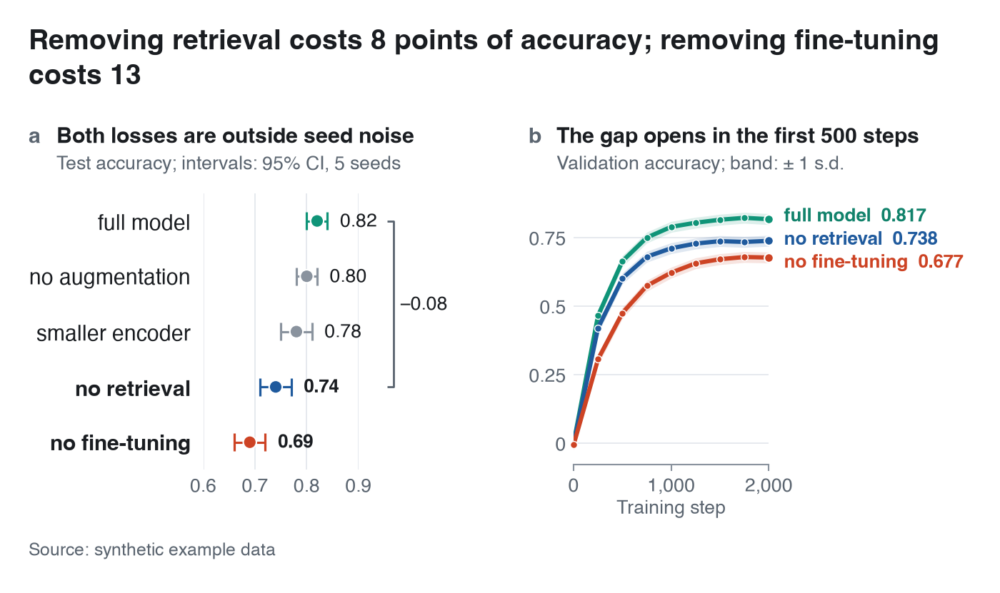

*Generator: [`explain_science_examples.py`](explain_science_examples.py)*

### Three-panel materials optimum (`fm.compare` log + `fm.trend` Arrhenius + `fm.compare`)


*Generator: [`explain_science_examples.py`](explain_science_examples.py)*

### Four-panel regression story (`fm.compare` + `fm.trend` + `fm.distribution` + `fm.share`)


*Generator: [`explain_chat_examples.py`](explain_chat_examples.py)*

---

## `fm.compare` — Size and intervals

Sorted bars from zero by default; switches automatically to dots with whiskers when `error=`, `zero=False`, or `log=True` is passed. Use `baseline=` to draw a control in ink and state every highlighted item against it in `facts`, and `n=` to show sample counts under each name.

### Signed effects with 95% CIs, `n=`, `baseline=`, and `reference=`


```python
fm.explain(
    "High-dose therapy cuts HbA1c by 1.4 points, 1.6 points below placebo",
    fm.compare(
        {"High dose": -1.4, "Standard dose": -0.7, "Low dose": -0.3,
         "Diet only": -0.1, "Placebo": 0.2},
        error={"High dose": (-1.7, -1.1), "Standard dose": (-1.0, -0.4),
               "Low dose": (-0.6, 0.0), "Diet only": (-0.4, 0.2), "Placebo": (-0.1, 0.5)},
        error_label="95% CI",
        n={"High dose": 62, "Standard dose": 60, "Low dose": 58, "Diet only": 55, "Placebo": 61},
        reference=(0, "no change"), baseline="Placebo", highlight="High dose",
        sort="asc", label="Change in HbA1c at 24 weeks", unit="%", fmt="+.1f",
        title="Both active doses stay well below zero",
    ),
    source="synthetic example data",
)
```

*Generator: [`explain_form_gallery.py`](explain_form_gallery.py)*

### Ranked bars paired with a timeline (`fm.compare` + `fm.trend`)


*Generator: [`explain_chat_examples.py`](explain_chat_examples.py)*

---

## `fm.trend` — Change over time, dose, or scale

Direct end labels (no legend), vertical `events=` markers, missing-value gaps, shaded uncertainty `band=`, raw observations via `points=` (with custom `points_label=`), log axes (`log=`, `log_x=`), and small multiples (`facet=True`).

### ISO dates, `events=`, `baseline=`, and a missing-data gap

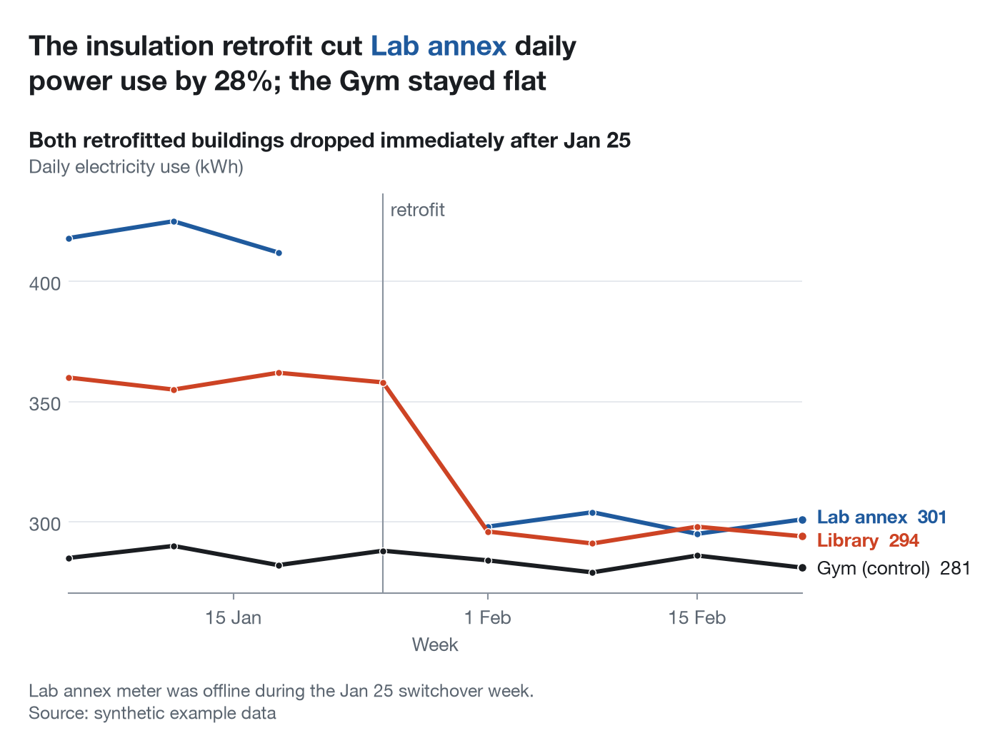

```python
fm.explain(
    "The insulation retrofit cut Lab annex daily power use by 28%; the Gym stayed flat",
    fm.trend(
        dates,
        {"Lab annex": [418, 425, 412, None, 298, 304, 295, 301],
         "Library": [360, 355, 362, 358, 296, 291, 298, 294],
         "Gym (control)": [285, 290, 282, 288, 284, 279, 286, 281]},
        baseline="Gym (control)", highlight=["Lab annex", "Library"],
        events={"2026-01-25": "retrofit"},
        label="Daily electricity use", unit="kWh", x_label="Week",
        title="Both retrofitted buildings dropped immediately after Jan 25",
    ),
    note="Lab annex meter was offline during the Jan 25 switchover week.",
    source="synthetic example data",
)
```

*Generator: [`explain_form_gallery.py`](explain_form_gallery.py)*

| Log-log power-law scaling (`log=True, log_x=True`) | Individual observations (`points=` + `points_label=`) |
| :---: | :---: |
|  |  |
| **Triplicate wells on log dose (`points=`, `log_x=True`)** | **Small multiples (`facet=True`) for > 4 series** |
|  |  |

*Generators: [`explain_form_gallery.py`](explain_form_gallery.py), [`explain_science_examples.py`](explain_science_examples.py), [`explain_chat_examples.py`](explain_chat_examples.py)*

---

## `fm.change` — Paired before and after

Slopegraph pairing two named states (`before`, `after`), showing absolute deltas inline and automatically wrapping in narrow columns.


```python
fm.explain(
    "The new model gains most where the old one was weakest: +50 points on AIME",
    fm.change(
        before, after,
        labels=("Prior", "New"), label="Accuracy", unit="%", highlight="AIME",
    ),
    source="synthetic example data",
)
```

*Generator: [`explain_chat_examples.py`](explain_chat_examples.py)*

---

## `fm.distribution` — Raw observations and spread

Every observation drawn as a dot with a median (or `stat="mean"`) mark and middle-half (IQR) or ± 1 s.d. bar, plus sample counts `n=` and automatic range-separation facts.

### Log-scale fold changes with `baseline=` and `reference=`


```python
fm.explain(
    "Drug treatment activates p53 targets (median 2.75×) and halves proliferation genes",
    fm.distribution(
        groups,
        log=True, baseline="Housekeeping", highlight=["p53 targets", "Proliferation"],
        reference=(1.0, "no change"), label="Expression fold change", unit="×",
        title="Every p53 target rises while every proliferation gene falls",
    ),
    subtitle="Bulk RNA-seq, 24 h post-treatment; each dot is one gene",
    source="synthetic example data",
)
```

### Small-n perturbation paired with mechanism (`fm.distribution` + `fm.relate`)


*Generators: [`explain_form_gallery.py`](explain_form_gallery.py), [`explain_science_examples.py`](explain_science_examples.py)*

---

## `fm.histogram` — Binned distributions

First-class alias for `fm.distribution(..., bins=...)`. Pass a single sequence for a histogram with automatic modal-bin and `% above reference` facts, or a dict of up to 4 groups for stacked shared-axis histograms (never muddy overlapping translucent bars).

### Single-variable bimodal histogram (`fm.histogram`)


```python
fm.explain(
    "Request latency splits into two modes near 18 ms and 44 ms; 32% exceed the 35 ms SLA",
    fm.histogram(
        latencies,
        bins=18,
        reference=(35.0, "35 ms SLA"),
        label="Response time",
        unit="ms",
        title="Cache hits cluster around 18 ms while misses peak near 44 ms",
    ),
    subtitle="220 sampled API requests over 1 hour; dashed line marks overall median",
    source="synthetic example data",
)
```

### Multi-group stacked histograms (`fm.distribution(..., bins=16)`)

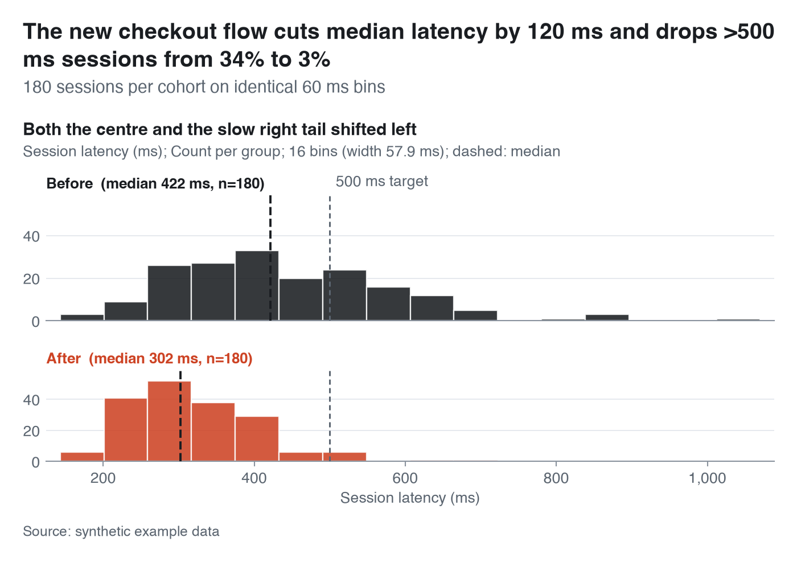

```python
fm.explain(
    "The new checkout flow cuts median latency by 120 ms and drops >500 ms sessions from 34% to 3%",
    fm.distribution(
        {"Before": before, "After": after},
        bins=16,
        baseline="Before",
        highlight="After",
        reference=(500.0, "500 ms target"),
        label="Session latency",
        unit="ms",
        title="Both the centre and the slow right tail shifted left",
    ),
    source="synthetic example data",
)
```

*Generator: [`explain_form_gallery.py`](explain_form_gallery.py)*

---

## `fm.relate` — Two continuous measures

Scatter plot with optional `groups=` (up to 4, directly labelled), `names=` (call out specific points with `highlight=`), `fit=True` least-squares lines with computed `r`, `n`, and 95% slope CIs, and `log_x=`/`log_y=`.

| Grouped scatter with per-group fits & 95% slope CIs | Log-log scatter with fitted power law & named points |
| :---: | :---: |
|  | 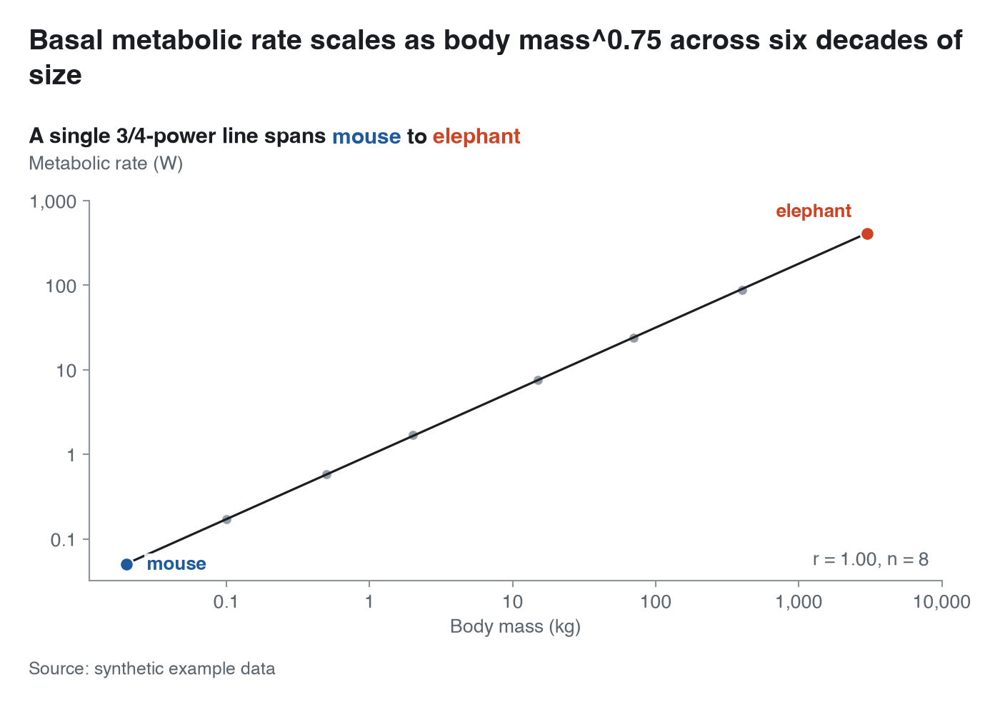 |

```python
fm.explain(
    "All three alloys follow Hall–Petch; Cu–Zn strengthens 2.3× faster than pure Cu",
    fm.relate(
        inv_sqrt_d, yield_mpa,
        groups=alloy, fit=True, highlight="Cu–Zn",
        x_label="d⁻½ (µm⁻½)", y_label="Yield strength (MPa)", unit="MPa",
        title="Grain refinement pays off steepest in Cu–Zn (r = 0.97)",
    ),
    source="synthetic example data",
)
```

*Generator: [`explain_form_gallery.py`](explain_form_gallery.py)*

---

## `fm.share` — Part of a whole

Sorted percentage bars (never a pie), folding smaller parts past `top=` into one muted `"Other (n)"` bar while reporting the total and combined highlighted share in `facts`.


```python
fm.explain(
    "Three stages take 82% of the build: compile, integration tests and image push",
    fm.share(
        stages,
        label="build time", unit="s",
        highlight=["compile", "integration tests", "image push"], top=6,
    ),
    source="synthetic example data",
)
```

*Generator: [`explain_chat_examples.py`](explain_chat_examples.py)*

---

## `fm.matrix` — Two categorical dimensions

Heat table with a number in every cell, automatic high-contrast text colour, highlighted cells/rows/columns, diverging ramps (`diverging=True`) for signed/correlation data, and centred em-dash (`—`) markers for missing (`NaN`) cells.

| Sequential with outlier highlight | Missing (`NaN`) cells as `—` |
| :---: | :---: |
|  | 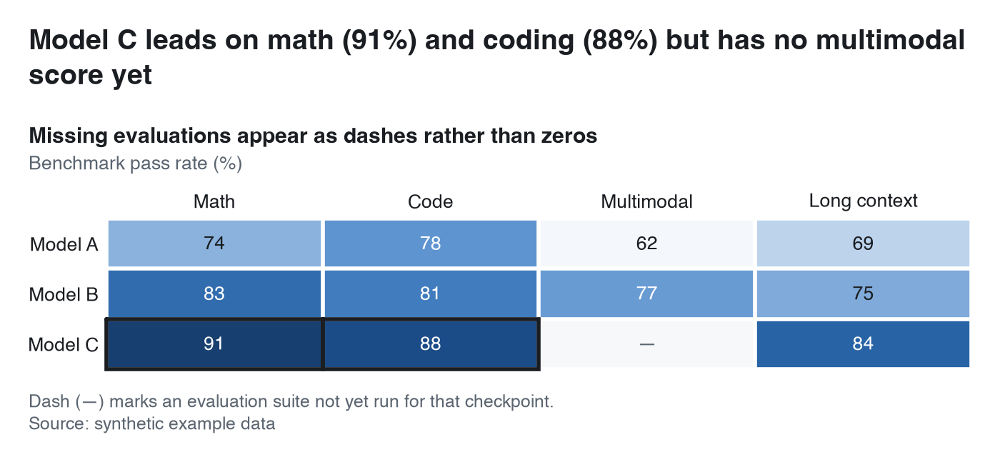 |

### Diverging correlation matrix (`diverging=True`)


*Generators: [`explain_chat_examples.py`](explain_chat_examples.py), [`explain_form_gallery.py`](explain_form_gallery.py), [`explain_science_examples.py`](explain_science_examples.py)*

---

## Themes & Color Palettes

Every built-in surface theme (`style=`) and color palette (`palette=`) is verified for deuteranopia, protanopia, grayscale luminance separation (`≥ 0.05`), and WCAG 4.5:1 text contrast. Mix and match freely: `fm.explain(..., style="paper", palette="okabe_ito")`.

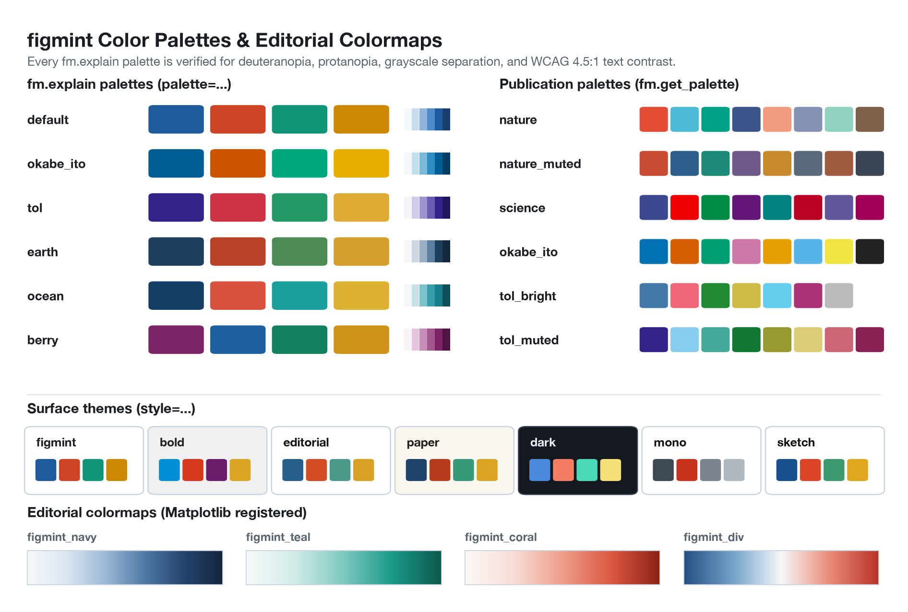

### Themes (`style=`)

The same two-panel comparison + trend rendered across all seven built-in surface styles:

| `style="figmint"` (default) | `style="editorial"` |
| :---: | :---: |
| 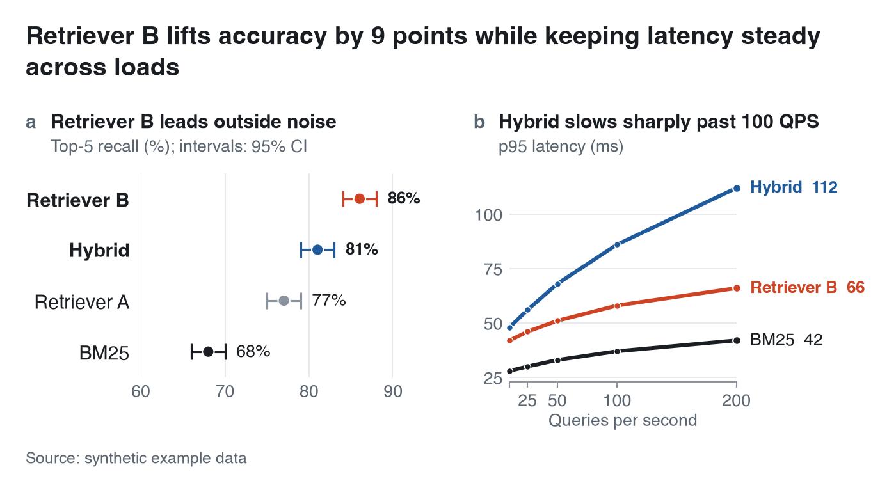 |  |
| **`style="paper"`** (warm ivory + serif) | **`style="bold"`** (matte gray + heavy strokes) |
|  |  |
| **`style="dark"`** (slate charcoal for dark UIs & slides) | **`style="mono"`** (monochrome print + single accent) |
| 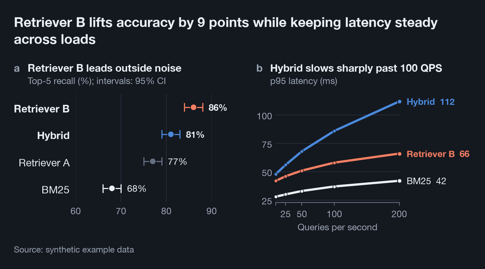 |  |

#### `style="sketch"` (hand-drawn, for conceptual or illustrative data)


### Color Palettes (`palette=`)

All six `fm.explain` color palettes shown on a four-series figure (so every colour slot — 3 accents + 4th series hue — is visible):

| `palette="default"` | `palette="okabe_ito"` |
| :---: | :---: |
| 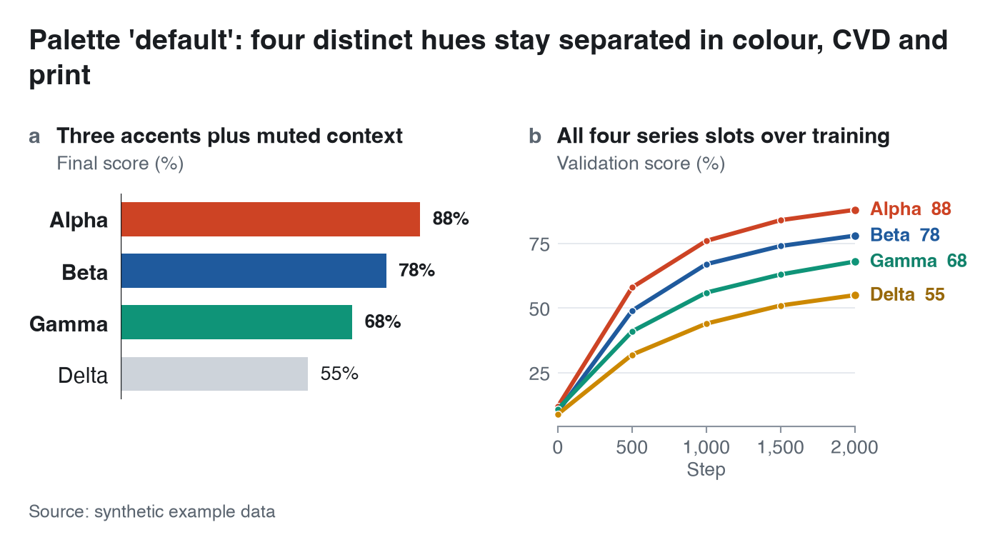 |  |
| **`palette="tol"`** | **`palette="earth"`** |
|  | 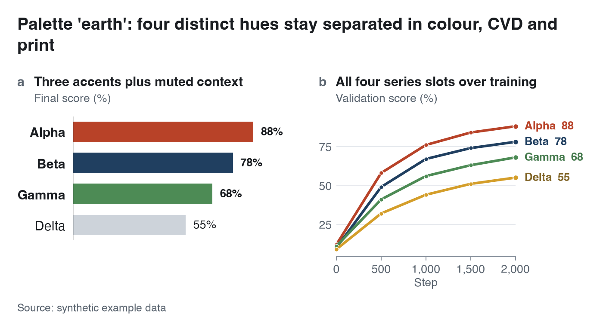 |
| **`palette="ocean"`** | **`palette="berry"`** |
| 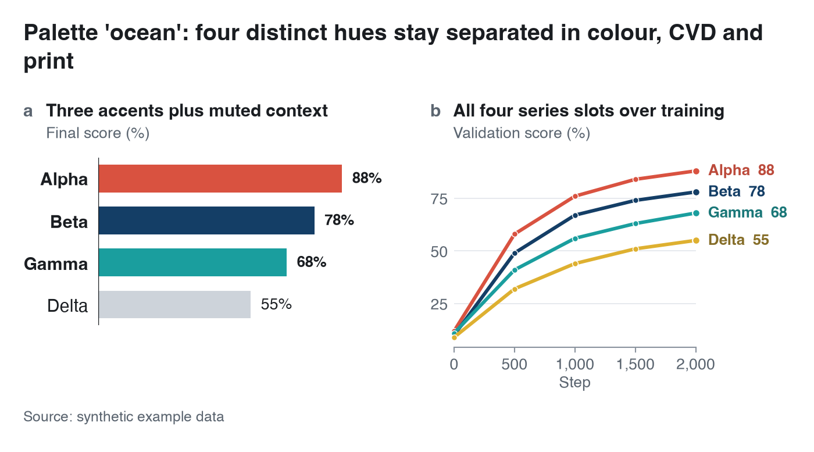 | 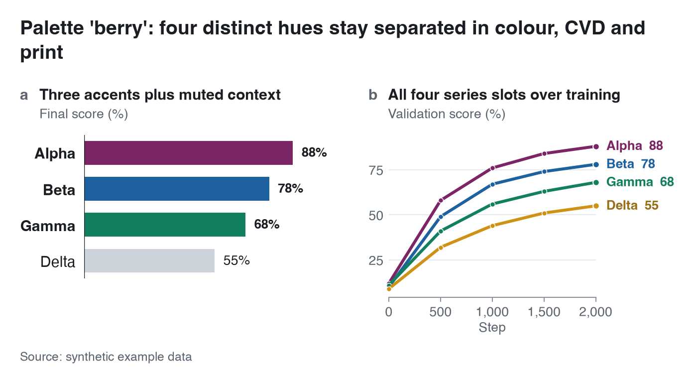 |

*Generator: [`explain_theme_palette_gallery.py`](explain_theme_palette_gallery.py) (plus the 6-figure style matrix in [`explain_style_showcase.py`](explain_style_showcase.py) → `output/explain_styles/`).*

---

## Editing returned figures and CLI

Every PNG saved by `fm.explain` embeds its normalized JSON spec. Rebuild and modify a figure without re-deriving the data:

```python
spec = fm.load("ablation.png").to_spec()
spec["style"] = "paper"
spec["palette"] = "okabe_ito"
spec["panels"][0]["highlight"] = ["no fine-tuning"]
print(fm.explain_from_spec(spec).save("ablation_v2.png", write_spec=True))
```

Or from the command line with no Python script:

```bash
figmint explain --example | figmint explain - --out latency.png
figmint explain --show-spec latency.png
figmint explain latency.png --style dark --palette ocean --out latency_dark.png
```

---

## Publication Figures (`fm.figure`, `fm.Plate`, `figmint run`)

Exact physical millimetre geometry, uniform sans-serif typography and math, Type 42 vector PDFs, automated CVD + grayscale proof sheets, and reproducible manuscript bundles. See [`benchmark_comparison.md`](benchmark_comparison.md) for the quantitative PDF/preflight audit.

### Before vs. After default Matplotlib


*Generator: [`generate_showcase.py`](generate_showcase.py)*

### One-line journal switch (*Nature* 183 mm vs. *Science* 184 mm)


*Generator: [`generate_showcase.py`](generate_showcase.py)*

### Multi-panel publication plates

| *Nature* double-column quantum phase diagram (`183 mm`) | *Science* 3-column exoplanet spectroscopy (`184 mm`) |
| :---: | :---: |
|  |  |
| [`nature_quantum_critical_dome.py`](nature_quantum_critical_dome.py) | [`science_exoplanet_atmosphere.py`](science_exoplanet_atmosphere.py) |
| **NeurIPS Tufte scaling + slopegraph + sparklines (`139.7 mm`)** | **Cell Press lineage bifurcation (`174 mm`)** |
|  |  |
| [`neurips_frontier_tufte.py`](neurips_frontier_tufte.py) | [`cell_lineage_bifurcation.py`](cell_lineage_bifurcation.py) |

### Automated CVD + grayscale proof sheet (`plate.bundle(...)`)


*More publication plates in this folder: [`masterpiece_1_chaos.py`](masterpiece_1_chaos.py), [`masterpiece_2_omics.py`](masterpiece_2_omics.py), [`masterpiece_3_climate.py`](masterpiece_3_climate.py), [`neurips_frontier_scaling.py`](neurips_frontier_scaling.py).*
