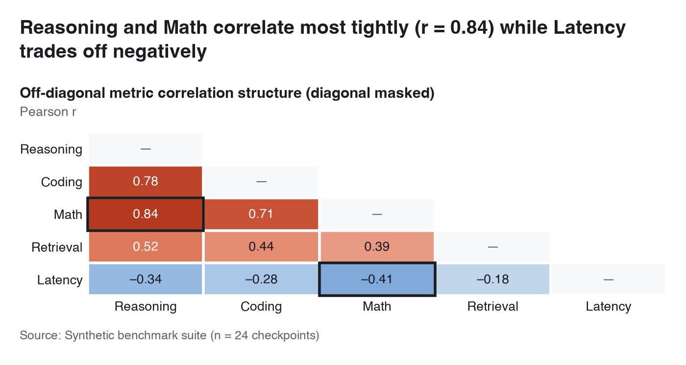

# Release Candidate & Pipeline Briefing

*Generated with mint.Session + mint.brief (zero-CDN HTML & Markdown)*

- Retrieval adds +8.2 points while int4 quantization costs only 1.5 points
- Integration tests account for 53% of CI wall time and exceed the 150 s SLA
- 58% of screened patients complete follow-up; eligibility screening is the largest drop

1. [Retrieval adds +8.2 points while int4 quantization costs only 1.5 points](#retrieval-adds-82-points-while-int4-quantization-costs-only-15-points)
2. [Integration tests take 94 s (53% of the 178 s CI run) and push past the 150 s SLA](#integration-tests-take-94-s-53-of-the-178-s-ci-run-and-push-past-the-150-s-sla)
3. [58% of screened patients complete follow-up; eligibility screening causes the largest drop (26%)](#58-of-screened-patients-complete-follow-up-eligibility-screening-causes-the-largest-drop-26)
4. [Reasoning and Math correlate most tightly (r = 0.84) while Latency trades off negatively](#reasoning-and-math-correlate-most-tightly-r--084-while-latency-trades-off-negatively)
5. [Alpha-3 leads Beta-Pro by 3.2 points and Baseline by 9.3 points on GPQA](#alpha-3-leads-beta-pro-by-32-points-and-baseline-by-93-points-on-gpqa)
6. [Quantized Alpha-3 (int4) retains 85.3% while cutting serving cost by 52%](#quantized-alpha-3-int4-retains-853-while-cutting-serving-cost-by-52)

## Retrieval adds +8.2 points while int4 quantization costs only 1.5 points

*Largest positive driver: +Retrieval (+8.2 points); largest negative drag: int4 quantization (−1.5 points).*

Source: Synthetic ablation suite (5 seeds per step)

## Integration tests take 94 s (53% of the 178 s CI run) and push past the 150 s SLA

*Longest stage: integration (94 s, 53% of wall span, 68 s to 162 s).*

Source: Synthetic CI execution trace

## 58% of screened patients complete follow-up; eligibility screening causes the largest drop (26%)

*Screened 1,240 patients → Completed 714 patients (57.6% retained; largest drop: Screened → Eligible (−328 patients, −26% of prior stage) (missing baseline labs).*

Source: Synthetic clinical cohort log

## Reasoning and Math correlate most tightly (r = 0.84) while Latency trades off negatively

*Highest: Reasoning × Math = 0.84.*

Source: Synthetic benchmark suite (n = 24 checkpoints)

## Alpha-3 leads Beta-Pro by 3.2 points and Baseline by 9.3 points on GPQA

*Range: 77.1% to 86.4% (spread 9.3 points).*

Source: Synthetic evaluation suite

## Quantized Alpha-3 (int4) retains 85.3% while cutting serving cost by 52%

*Highest: Alpha-3 (int4) 85.3%.*

Source: Synthetic serving telemetry

Briefing source: Synthetic workflow gallery
