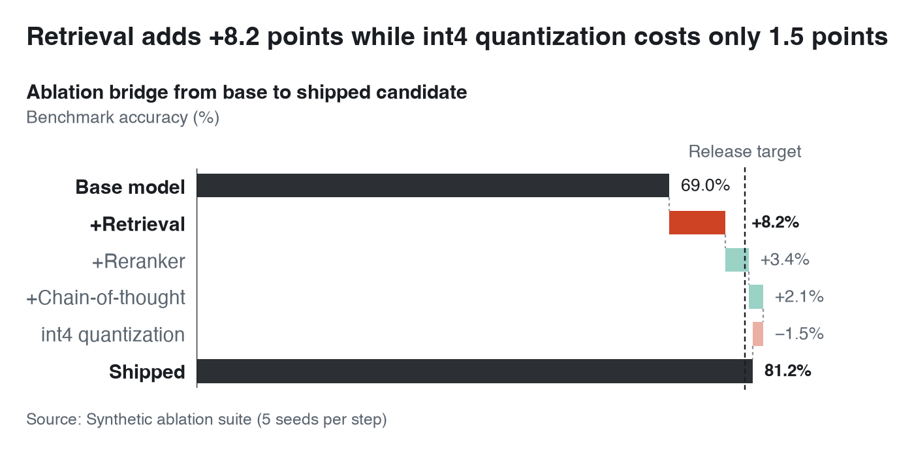
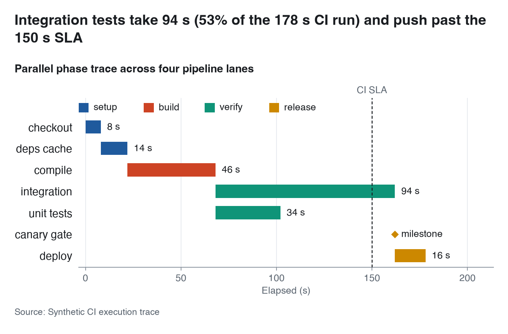
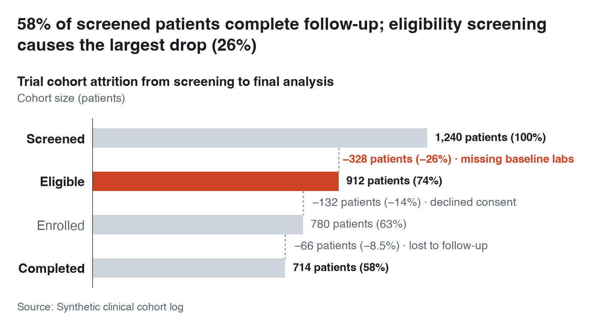
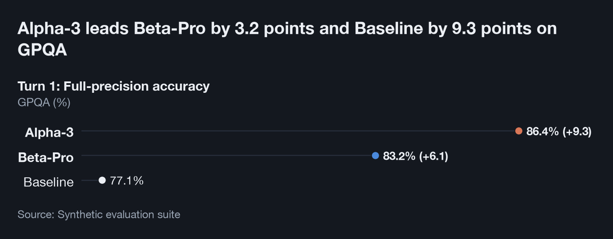
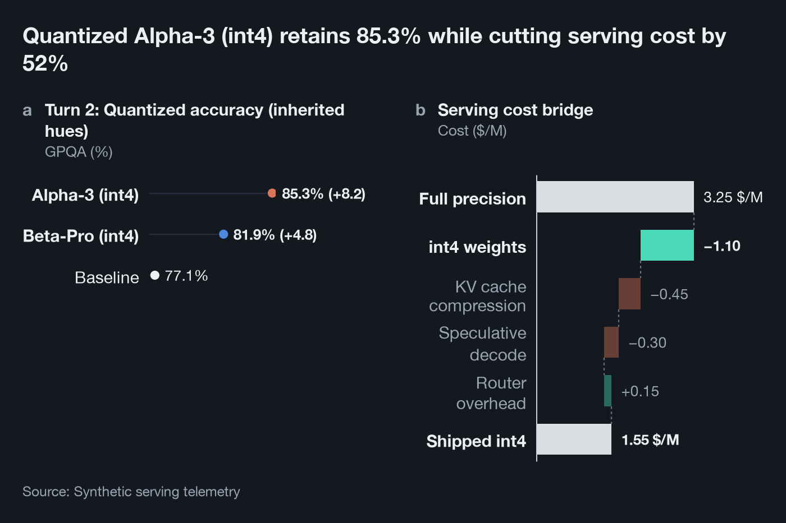

# Release Candidate & Pipeline Briefing

*Generated with fm.Session + fm.brief (zero-CDN HTML & Markdown)*

## Key findings

- Retrieval adds +8.2 points while int4 quantization costs only 1.5 points
- Integration tests account for 53% of CI wall time and exceed the 150 s SLA
- 58% of screened patients complete follow-up; eligibility screening is the largest drop

---

## 1. Retrieval adds +8.2 points while int4 quantization costs only 1.5 points

- +Retrieval: +8.2 points (cumulative 77.2%)
- Shipped vs reference 80.0% (Release target): +1.2 points
- Base model 69.0% → Shipped 81.2% (net +12.2 points)
- largest positive driver: +Retrieval (+8.2 points)

*Source: Synthetic ablation suite (5 seeds per step)*

---

## 2. Integration tests take 94 s (53% of the 178 s CI run) and push past the 150 s SLA

- wall span: 0 s to 178 s (178 s total across 7 stages)
- end 178 s exceeds reference 150 s (CI SLA) by 28 s
- longest stage: integration (94 s, 53% of wall span, 68 s to 162 s)
- sum of stage durations: 212 s (1.2× wall span; peak 2 stages overlapping)

*Source: Synthetic CI execution trace*

---

## 3. 58% of screened patients complete follow-up; eligibility screening causes the largest drop (26%)

- Eligible: 912 patients (73.5% of Screened, −328 patients (−26%) from Screened: missing baseline labs)
- Screened 1,240 patients → Completed 714 patients (57.6% retained; 526 patients dropped across 3 steps)
- largest drop: Screened → Eligible (−328 patients, −26% of prior stage) (missing baseline labs)

*Source: Synthetic clinical cohort log*

---

## 4. Reasoning and Math correlate most tightly (r = 0.84) while Latency trades off negatively

- highest: Reasoning × Math = 0.84
- lowest: Math × Latency = −0.41
- diagonal masked from colour scale and extrema

*Source: Synthetic benchmark suite (n = 24 checkpoints)*

---

## 5. Alpha-3 leads Beta-Pro by 3.2 points and Baseline by 9.3 points on GPQA

- highest: Alpha-3 86.4%
- lowest: Baseline 77.1%
- range: 77.1% to 86.4% (spread 9.3 points)
- Alpha-3: 86.4% (rank 1 of 3, highest first)

*Source: Synthetic evaluation suite*

---

## 6. Quantized Alpha-3 (int4) retains 85.3% while cutting serving cost by 52%

- [a] highest: Alpha-3 (int4) 85.3%
- [a] lowest: Baseline 77.1%
- [a] range: 77.1% to 85.3% (spread 8.2 points)
- [a] Alpha-3 (int4): 85.3% (rank 1 of 3, highest first)
- [b] Full precision 3.25 $/M → Shipped int4 1.55 $/M (net −1.70 $/M)

*Source: Synthetic serving telemetry*

---

*Briefing source: Synthetic workflow gallery*
